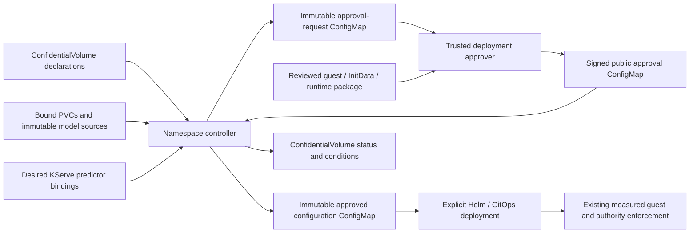

# ConfidentialVolume reconciliation

The `confidential-volumes` Helm chart now includes a namespace-scoped controller,
CRD status subresource and restricted RBAC. The controller uses the existing
compiler and the existing Pod/KServe binding annotation. It adds no storage keys,
privileged containers or changes to the running guest storage protocol.



The controller performs discovery, resolution, deterministic compilation, signed
approval verification, artifact publication and status reconciliation automatically.
Trusted approval, measured guest packaging and workload rollout remain explicit.
This separation means a Kubernetes edit cannot authorize first formatting, replace
an existing RW key or reset authority history. An approval of a deployment package
is not itself the storage authority's initialization approval or a Trustee policy.

The controller observes **desired configuration**. `Approved` does not assert that
an application is running or a filesystem mounted. It does not patch KServe,
launch an unapproved workload or stop a running workload when an approval expires.
KServe readiness and actual guest/authority evidence remain separate checks.

## Qwen objects

The declarations `qwen-gpu-model` and `qwen-gpu-data` resolve the existing
`qwen-luks-model-v1` and `qwen-gpu-data-v1` claims in `confidential-storage-test`.
Their specs and claim UIDs are unchanged from the
[Qwen walkthrough](qwen-storage-walkthrough-and-gaps.md). The new controller
resolves them against `InferenceService/qwen-storage`; it does not modify that
InferenceService or reconstruct its storage state.

Inspect the generated contract and publication references:

```sh
oc get confidentialvolumes -n confidential-storage-test
oc get confidentialvolume qwen-gpu-model -n confidential-storage-test -o json
```

A status entry has the following shape (digests/names abbreviated):

```yaml
status:
  observedGeneration: 1
  resolvedClaimUID: 997cefd0-0f9b-4325-b57e-b5220cc08d3e
  phase: Approved
  consumers:
    - kind: InferenceService
      name: qwen-storage
      uid: 3994808f-5baf-4eed-92e9-c40e75fdf9f2
      phase: Approved
      reason: SignedConfigurationPublished
      requestSha256: <full-request-digest>
      requestConfigMap: cv-request-<digest-prefix>
      approvalSha256: <full-approval-digest>
      artifactConfigMap: cv-approved-<digest-prefix>
      expiresAt: <approval-expiry-Unix-seconds>
  # Resolved, Approved and ConfigurationPublished conditions also include
  # observedGeneration and lastTransitionTime. No StorageReady is inferred.
```

`WaitingForConsumer` means the claim resolves but no discovered workload binds the
declaration. `AwaitingApproval` means a valid request was published and no signed
approval is present. `Blocked` covers unresolved/invalid inputs, conflicting
artifacts or rejected/expired approvals. Per-consumer reasons identify the phase.
Transient API failures retain the last status until successful resync; controller
readiness detects an extended failure to reconcile. Status is never guest authority.

## For another workload

1. Create/populate the model PVC and create the separate new RW claim.
2. Create ConfidentialVolume objects with their actual claim UIDs and explicit
   profiles, keys, initialization policy and destination bindings in the desired
   KServe predictor. The controller sees these on its next resync.
3. Export its immutable request. The trusted deployment approver resolves the
   exact public guest package and independently confirms the storage-authority and
   Trustee approvals. Sign the package for this request, workload incarnation and
   cluster identity. No credential is placed in the request or package.
4. Publish the public signed approval ConfigMap. The controller verifies it and
   publishes an immutable configuration artifact, then updates status.
5. Deploy through the reviewed Helm/GitOps path using that approved configuration
   and its matching measured runtime. A controller status transition alone does
   not install a new guest image or authorize a different workload process.

The small initial controller deliberately has no authority-enrollment API or
workload-write RBAC. The next integration step is a trusted approval/build service
and supported guest configuration delivery, followed by an explicit gated rollout
workflow. It is no longer necessary to run the compiler manually to discover
changes, resolve live identities or publish per-workload approval requests.

## Component changes and security boundaries

- [Controller source and operational guide](../../components/confidential-volume-controller/README.md):
  periodic namespace resync, bounded API responses, CA-verified API access,
  rotating projected token, deterministic immutable artifacts and optimistic
  status updates. No API redirects, external approval URL or Secret permission.
- [CRD](../../charts/coco-supported/confidential-volumes/crds/confidentialvolumes.yaml):
  immutable spec retained; adds status schema, status subresource and printer columns.
- [Helm chart](../../charts/coco-supported/confidential-volumes/): opt-in controller,
  public signer keyring, digest-pinned build, non-root/read-only deployment and
  namespace-only RBAC. Existing schema-only mode remains available.
- [Offline approval interface](../../components/confidential-volume-controller/approve.py):
  separate Ed25519 signing key held outside the controller. Approves public
  configuration provenance, not disk/key operations.

The running lab uses one configured namespace and SNP runtime metadata. Generic
profiles, larger RW layouts, automatic approval renewal, safe artifact garbage
collection, crash recovery/fencing and generic guest configuration delivery remain
separate work. Public ConfigMap transport and controller status must not become
an alternate trust root that bypasses measured guest and Trustee checks.

## Live validation — 14 October 2026

The controller is running in `confidential-storage-test` from image digest
`sha256:f691827a836ce171e27eb1866a15327640bf971fe5590bdb21e11560cc15b55f`.
Both `qwen-gpu-model` and `qwen-gpu-data` transitioned from AwaitingApproval to
Approved. A deliberately invalid signature changed both to Blocked with
`InvalidApproval`; restoring the reviewed approval restored Approved. Restarting
only the controller retained the same request and approved-artifact object UIDs.

The package was checked against v19's exact InitData, process, image, environment,
security context, attachments and runtime class before signing. The 24-hour lab
approval expires independently of the running guest; renewal remains a trusted
issuer operation. No storage-authority records, keys, guests or Qwen templates
were changed by this controller deployment.

All 21 controller tests and 15 existing compiler tests passed locally and in the
OpenShift image build. Helm lint/render and OpenShift server dry-run passed.
Live impersonation checks confirmed the controller cannot read Secrets, patch
PVCs or InferenceServices, or create Pods. A fresh chatbot inference passed and
both original and storage-enabled Qwen/chatbot pod identities and zero restarts
were retained. The repository-wide `pattern.sh` checks could not access the local
Podman socket from the sandbox.

- [Validation and current status snapshot](../../tests/confidential-storage/evidence/2026-10-14/volume-controller/validation.json)
- [Live signature rejection](../../tests/confidential-storage/evidence/2026-10-14/volume-controller/signature-denial.json)
- [Fresh chatbot inference](../../tests/confidential-storage/evidence/2026-10-14/volume-controller/chat-audit.json)
- [Preserved workload identities](../../tests/confidential-storage/evidence/2026-10-14/volume-controller/preserved-workloads.json)
- [Public deployment values](../../overrides/values-confidential-volume-controller-edge.yaml)
