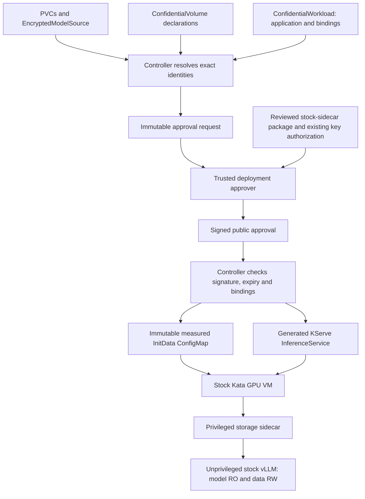

# Automatic deployment of approved stock-Kata sidecar workloads

The namespace ConfidentialVolume controller now accepts a `ConfidentialWorkload`
resource containing an ordinary KServe predictor template and volume bindings.
It resolves the existing ConfidentialVolume/PVC/source objects, obtains a signed
public deployment package, publishes its measured configuration and reconciles the
KServe InferenceService. Kata, vLLM, KServe, Trustee and CSI sources/images remain
unchanged. The custom code lives in our controller and existing storage add-ons.

Automatic deployment starts **after a valid signed package is available**. This
change does not turn the reconciler into an approval signer or silently enroll
new keys/volumes. The lab uses the existing offline trusted signer. A production
approval service can publish the same envelope; automatic approval issuance and
renewal are separate from this controller's deployment reconciliation.

For the proposed **separate add-on repository** and a fresh installation starting
from CoCo VP, see the [implementation plan](confidential-inference-pattern-plan.md)
and [clean-install demo specification](qwen-clean-cluster-demo-plan.md). Those
future install targets are not implemented by this controller deployment alone.

## Why a separate workload declaration

The desired application and generated two-container predictor must be distinct.
Otherwise the controller would see its own sidecar injection as a changed request,
invalidate the approval and trigger a reconciliation loop. `ConfidentialWorkload`
is our small namespaced intent API; KServe's InferenceService remains its generated
output. No KServe webhook or Kata plugin is added.



The full lab input is in
[`tests/confidential-storage/controller-sidecar/qwen-workload.json`](../../tests/confidential-storage/controller-sidecar/qwen-workload.json).
It specifies one application container and the model/data bindings; it contains
no storage helper, private key, raw device attachment or InitData blob. The tested
application startup includes model hashes, persistence and CUDA checks before
executing vLLM. Its image is unchanged.

Abridged structure (the image, command, resources and existing declarations must
match the separately reviewed package):

```yaml
apiVersion: storage.confidentialcontainers.org/v1alpha1
kind: ConfidentialWorkload
metadata:
  name: qwen-storage
  namespace: confidential-storage-test
spec:
  # Migration only: exact UID of an existing, otherwise unowned InferenceService.
  # Omit for a new installation; never copy another cluster's UID.
  adoptExistingUID: <existing-inferenceservice-uid>
  template:
    metadata:
      name: qwen-storage
      annotations:
        serving.kserve.io/deploymentMode: Standard
    spec:
      predictor:
        annotations:
          storage.confidentialcontainers.org/bindings: >-
            [{"volume":"model","confidentialVolume":"qwen-gpu-model",
              "container":"kserve-container","mountPath":"/models/qwen"},
             {"volume":"data","confidentialVolume":"qwen-gpu-data",
              "container":"kserve-container","mountPath":"/data"}]
        containers:
          - name: kserve-container
            image: <approved-stock-vllm-image@sha256:digest>
            command: [vllm, serve, /models/qwen]
            # Resources/security context omitted here; use the complete example.
```

The controller assigns transport device names deterministically in binding order.
The signed package supplies the approved helper, rendezvous startup command,
private guest configuration and final predictor. It validates the unchanged
application image, measured InitData, guest binding paths, key-reference allowlist,
raw-device separation, guest-memory targets, stock RuntimeClass and application
privileges. The trusted issuer still reviews policy semantics and hardware identity.

The controller creates the target if absent. It adopts an existing target only
when the signed intent contains its exact UID and it has no existing owner.
Thereafter ownership is tied to the ConfidentialWorkload UID. It repairs drift and
recreates a deleted generated InferenceService while the approval remains valid.
Changing intent, claims or source identity requires a matching new approval.
Concurrent updates use Kubernetes resourceVersion checks. No adoption by name alone.

`Approved / ApprovedWorkloadApplied` means approved desired configuration was
applied, **not** that keys were released or inference is healthy. Check KServe
readiness and guest/authority evidence separately. An invalid or expired approval
blocks new writes/recreation; it does not terminate an already running workload
or revoke keys it already received. Deleting the ConfidentialWorkload allows normal
Kubernetes garbage collection of its generated InferenceService, while PVCs,
keys, authority history and public audit artifacts are retained.

## One-time setup on a new installation

| Area | Required setup | Confidential material / owner |
| --- | --- | --- |
| Platform | Supported SNP GPU host, stock OpenShift sandboxed-containers runtime, confidential GPU configuration and KServe | Existing cluster administration credentials |
| Storage | A CSI driver supporting Block PVCs and the required RWOP/attachment behavior; registry; custom model-source CRD and volume populator | Registry credentials only if needed; populator does not receive model decryption keys |
| Guest add-on | Build/review the sidecar against the installed stock guest version; pin its image and matching tools/modules | Image contains public code/tools only; do not embed credentials |
| Guest security | Dedicated sidecar service account/SCC and admission guard; pin images, allowed claims and stock RuntimeClass | No Kubernetes API token in the confidential workload |
| Trustee | Deploy standard Trustee; configure TLS trust, CPU/GPU appraisal, reference values and resource policy | Key backend/admin credentials remain with the trusted administrator |
| Storage authority | Deploy the additional authority with TLS, signing material and durable retained state; configure guest trust | Private receipt/TLS keys stay outside the controller; production history/fencing must be independently protected against rollback |
| Deployment approval | Establish Ed25519 approval signer and controller public keyring; define review, renewal and revocation ownership | Private signing key stays outside the controller and its namespace; only public signed packages are published |
| Controller | Install both CRDs, controller, namespace RBAC and target admission guard; configure cluster identity and explicit target names | Projected, restricted service-account token; no Secret reads, exec, PVC writes or Trustee administration |

All namespaced Helm objects now render `.Release.Namespace` explicitly. Apply the
admission guard before granting the controller workload-write permission. Helm
ordinary upgrades do not update CRDs automatically; apply reviewed CRD files first.
The controller deployment uses a digest-pinned image, non-root UID, read-only root
and no added capabilities. `controller.sidecarWorkloads: []` keeps publication-only
behavior. A named allowlist enables KServe creation/update for those targets only;
an admission policy limits creation, which RBAC resourceNames cannot constrain.
Named `delete` permission is also required by Kubernetes
OwnerReferencesPermissionEnforcement when adopting an existing target. The
controller does not issue DELETE requests; deletion permission is limited to the
same explicit target names, and owner references enable normal garbage collection.

For a different cluster, review the stock-runtime/guest-module versions and
hardware reference values. The lab's launch measurement, certificates, PVC UIDs,
registry addresses and approval signatures are not portable defaults.

### Installation order and repository entry points

1. Verify the existing stock GPU RuntimeClass and KServe can run the approved
   confidential GPU workload. This extension installs no Kata handler, kernel,
   agent, initrd, NVIDIA driver or vLLM replacement.
2. Install the [encrypted model populator](model-populator.md#build-and-deploy-the-isolated-controller)
   and its `EncryptedModelSource` CRD, with a pinned image, registry TLS trust,
   namespace and block storage class. Keep publisher permissions separate from the
   importer. Skip reinstalling it on the existing Qwen cluster.
3. Deploy the [storage authority](../../components/confidential-storage-authority/README.md)
   and its [GPU deployment configuration](../../tests/confidential-storage/gpu-guest/README.md),
   using retained state, TLS and the standard Trustee RCAR authentication path.
   Provision private signing/TLS material through the trusted secret backend;
   never initialize a replacement database over an existing authority history.
4. Build the [storage sidecar](../../components/confidential-storage-sidecar/README.md),
   pin its digest and review the [Qwen renderer inputs](../../tests/confidential-storage/stock-agent-sidecar/qwen-example/).
   Install the sidecar admission policy first, verify its CEL type checking, then
   enable its dedicated service account and SCC. The existing example's
   `admission-values.json` demonstrates the required image and claim allowlists.
5. Install the workload controller as below, using a reviewed values file with
   `controller.enabled`, digest-pinned `controller.image`, stable `clusterId`,
   public `approvalKeys` and explicit `sidecarWorkloads`. Its signer private key
   stays with the release approver. No cluster credential is put in the workload.

For step 5, from the repository root, with the target namespace already created:

```bash
oc apply -f charts/coco-supported/confidential-volumes/crds/
helm template confidential-volumes charts/coco-supported/confidential-volumes \
  -n confidential-storage-test -f reviewed-controller-values.yaml \
  --show-only templates/deployment-admission.yaml > controller-admission.yaml
oc apply -f controller-admission.yaml
oc get validatingadmissionpolicy confidential-storage-test-confidential-workload-targets \
  -o jsonpath='{.status.typeChecking}'
# Resolve any expression warnings before granting the controller its Role.
helm template confidential-volumes charts/coco-supported/confidential-volumes \
  -n confidential-storage-test -f reviewed-controller-values.yaml > controller.yaml
oc apply --dry-run=server -n confidential-storage-test -f controller.yaml
oc apply -n confidential-storage-test -f controller.yaml
oc rollout status -n confidential-storage-test deployment/confidential-volume-controller
```

These are rendered Helm resources applied with `oc`, matching the lab's existing
installation ownership; they are not a Helm-managed release. For GitOps, use the
same chart/values with admission-before-RBAC ordering. Do not also sync a manually
maintained `qwen-storage` InferenceService: `ConfidentialWorkload` now owns it.
The existing lab override is
[`values-confidential-volume-controller-edge.yaml`](../../overrides/values-confidential-volume-controller-edge.yaml);
its image, public key and cluster identity are examples, not portable defaults.

## Per-volume and per-release preparation

These are not blanket one-time authorizations for arbitrary future volumes:

1. The trusted producer prepares the encrypted model disk and integrity manifest,
   publishes it by OCI digest, and provisions its key in Trustee's trusted backend.
   The populator copies ciphertext into the model PVC.
2. Create the RW Block PVC, generate/provision its separate key and enroll its
   identity/profile in the storage authority. First formatting requires explicit
   `OnceIfApproved` authority approval. Existing initialized volumes retain their
   key, header, generation and journal; never initialize them again to migrate.
3. Enable the target name in `controller.sidecarWorkloads` and the workload
   claims/images in the sidecar admission values. Apply admission changes before
   the corresponding RBAC/SCC permissions. Declare both ConfidentialVolumes with
   the actual claim UIDs and key references. Apply ConfidentialWorkload. The controller publishes `status.requestConfigMap`.
4. In the trusted release process, render/review the sidecar deployment with the
   existing sidecar tools, confirm Trustee and authority authorization, and package
   its public files with `prepare-sidecar-package.py` against that request.
5. Sign with `approve.py`, publish the public approval ConfigMap, and let the
   controller publish configuration and deploy KServe. No manual KServe patch or
   helper injection is needed. Renew approvals before expiry if automatic recreation
   must remain available.

Example trusted packaging/signing commands from the repository root:

```bash
python3 components/confidential-volume-controller/prepare-sidecar-package.py \
  --request request-configmap.json \
  --workload reviewed-sidecar-kserve.json \
  --configuration reviewed-configuration.json \
  --runtime reviewed-runtime.json --output public-package
python3 components/confidential-volume-controller/approve.py \
  --request request-configmap.json --artifacts public-package \
  --key /secure/deployment-approval.pem --key-id storage-release-v1 \
  --lifetime 86400 --output public-approval.json
oc apply -n confidential-storage-test -f public-approval.json
oc get confidentialworkload,confidentialvolume,inferenceservice -n confidential-storage-test
```

A signed package is public configuration. It must not include volume keys, registry
passwords, private TLS/signing keys or authority databases. The controller never
fetches these. Runtime decryption and attestation remain inside the confidential VM.

## Validation scope

The [live Qwen evidence](../../tests/confidential-storage/evidence/2026-10-14/controller-sidecar/)
records the controller-managed adoption and recreation. The
migration reuses the existing populated model PVC and initialized RW PVC; it does
not re-run population or claim a new first-use formatting test through the sidecar.
The controller adopted the approved existing service, survived its own restart
without changing the KServe spec/resource version, and recreated the generated
service with a new UID after deletion. Both fresh VMs passed model-file hashes,
the persisted data canary, CUDA and actual chatbot requests; exec was denied in
both containers. A tampered signature blocked adoption. The original Qwen pod
remained ready with the same UID and zero restarts.

Foreground garbage collection required explicit cleanup of two old completed pod
API records after confirming their containers exited zero and CRI sandboxes were
absent. This infrastructure cleanup is recorded in the evidence; the test did not
reset authority ownership or disk state. Do not treat this as autonomous recovery
from an unclean VM crash. The lab approval is time-limited; renew it to preserve
future automatic recreation after its recorded expiry.

Independent crash fencing, automatic trusted approval issuance/renewal and broader
runtime/application compatibility remain separate work. See the
[stock-sidecar architecture and limits](stock-kata-qwen-storage-addon.md).
