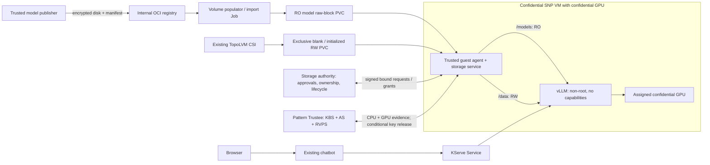

# Qwen/KServe: confidential GPU inference with RO model and RW data PVCs

Implementation progress is tracked in the [14 October checkpoint](multi-volume-implementation.md);
planning tables below describe the target and original baseline.

**Status: implementation plan, not deployed.** Prepared 14 October 2026 against
`dev/confidential-storage-integration` at `328c30b`, with a fresh read-only cluster
inventory. The completed CPU storage examples are the implementation baseline;
they do not constitute acceptance of this GPU integration.

Design update: reuse the working Qwen GPU guest's existing AA/CDH and standard
Trustee composite-attestation path. The CPU-only storage test client is not the
GPU integration baseline. Start with the available encrypted model disk/PVC and
its matching credential rather than requiring a fresh publication. Introduce the
[ConfidentialVolume and authenticated bindings API](confidential-volume-api-proposal.md)
for a bounded number of RO and RW volumes; the first serving example uses one each.
For the minimum initial change set and the distinction between stock-platform
gaps and prototype limitations, follow the
[component matrix and staged delivery](minimal-integration-and-stock-gaps.md).
Generate approved bindings explicitly first; the new API's continuously running
controller is a later automation step, not a prerequisite for the first GPU E2E.

## 1. Required outcome

One KServe-managed confidential GPU pod must:

1. Load Qwen3-0.6B from `/models`, mounted read-only by trusted guest code from a
   raw-block PVC populated from an encrypted LUKS OCI artifact in the internal
   OpenShift registry.
2. Receive `/data`, mounted read/write by the same guest service from a separate,
   exclusive raw-block PVC. The guest initializes a new approved blank claim
   once, then reopens it without formatting on later VM launches.
3. Retrieve both distinct volume credentials from the **existing validated
   pattern's Trustee**, with fresh CPU and GPU attestation required for release.
4. Run the actual vLLM engine on the assigned confidential GPU, with no CPU
   inference fallback, and answer requests through KServe and the existing chat UI.
5. Keep the application non-root, with all capabilities dropped, no privilege
   escalation, no raw storage devices, and no AA/CDH/storage-control sockets.

The application obtains files, not LUKS keys or permission to perform mounts.
Guest infrastructure remains privileged inside the VM. Standard CSI continues
to provision and attach ciphertext block devices; this milestone does not require
a new CSI driver.

Initial scope is one predictor replica, one GPU, a 2 GiB RO model claim and a
1 GiB RW demonstration claim, using the already tested disk geometries. Larger
RW volumes need separately verified integrity geometry, format timeouts and
capacity tests. Do not silently generalize the current fixed profile.

## 2. Verified starting point

| Area | Current state | Integration consequence |
| --- | --- | --- |
| Platform | OCP 4.22.15; node `9c-63-c0-dd-06-52` | Preserve current node/runtime baseline |
| KServe | Controller v0.20.0; `encrypted-qwen` in `gpu-workload`; deployment mode `Standard`; strategy `Recreate`; min/max replicas 1 | Extend the KServe deployment, not the obsolete standalone Deployment |
| Predictor | `encrypted-qwen-predictor-c68947bb9-gw9ml`, Running, 2/2 ready, zero restarts | Existing service remains the reference until candidate passes |
| Runtime/resources | `kata-cc-nvidia-gpu` → `kata-snp-nvidia-gpu`; 8 vCPU, 64 GiB, one `nvidia.com/pgpu` | Build a separate GPU/storage guest and handler |
| Serving image | NVIDIA vLLM digest `15f380ad9c32f0ac57ac16e4b778c6f733c88b9ffe3a936035d0a59ad17b1aab` | Preserve the working engine baseline; pin any derived image |
| Current data path | Memory-backed `/private`, model download/decrypt wrapper, `/results` sidecar; no block PVCs | Replace this model path rather than retaining a fallback download |
| GPU capacity | Qwen and `gpu-encrypted-file` each consume one physical GPU | No spare GPU for a parallel candidate today |
| Chat | `qwen-chat`, NodePort 30080; backend `http://encrypted-qwen.gpu-workload.svc:8000` | Keep the existing external link; switch backend only after acceptance |
| Trustee | `trustee-operator-system/kbsconfig`, `AllInOneDeployment`; KBS image digest `85312d29d6ea7b96396b567c96893ae2527d83b9fc7a459044ba610c98593fae` | Integrate with this managed deployment and its trust roots |
| Trustee configuration | `attestation-policy`, `resource-policy`, `rvps-reference-values`; existing HTTPS and attestation certificate Secret references | Add scoped resources/policies without replacing existing rules |
| Existing RO/RW tests | Both claims remain Bound in `confidential-storage-test`; compiler pod is Succeeded | Temporary test AS/KBS/authority are not a running integration backend |
| GitOps | Live apps track `codex/edge-rtx6k`; storage work is on `dev/confidential-storage-integration` | Reconcile branch differences before enabling anything |

The live Trustee application uses `charts/hub/trustee-edge`. The implementation
checkout still contains older chart wiring, including a standalone Qwen Deployment.
Copying that checkout's old chart into production would undo the KServe migration.
Reconcile the live branch deliberately and preserve the colleague's changes.

The fresh inventory checked object state/configuration, not a new inference call
or new hardware attestation. Some older checkpoint documents still say RW work
is incomplete; [the RW result](native-rw-storage.md) supersedes those statements.

## 3. Target architecture and trust boundaries



Trustee evaluates attestation and releases credentials. The storage authority is
an additional component: it records approved model versions, immutable header
identities, RW first-use steps and exclusive ownership. Stock Trustee does not
replace that lifecycle database. The authority must not hold volume decryption
keys; the populator and CSI must never receive them.

The trusted publisher necessarily handles model plaintext and its encryption
credential while constructing the artifact. Provision that same credential to
Trustee through the pattern's secret backend/ESO flow. The guest retrieves it only
after attestation and a valid local authority permit. The RW credential is separate.

Storage, OCI tags, Kubernetes annotations and PVC names are untrusted inputs.
Authorization pins artifact digest, authenticated manifest/verity root, model
generation, disk/header identity, profile and destination. A PVC UID is useful
administrative binding; it is not hardware-authenticated disk identity by itself.
No storage-hardware attestation is needed for this threat model.

The trusted Trustee/authority administration and persistent state remain outside
the untrusted workload-storage boundary. Hosting them in the same cluster retains
the existing PoC trust assumption about their administrators. An attacker able to
read Trustee's key backend or roll back the authority database defeats that boundary.

## 4. Critical implementation gaps

| Gap in current code | Required change |
| --- | --- |
| Agent has one `expected` binding, one `/dev/encrypted-data`, one consumer and one mount result | Support a bounded list of authenticated storage bindings for the same measured consumer |
| Agent clears all passed devices and strips all host bind mounts | Remove raw storage access while preserving only validated GPU device/library provisioning; never broadly restore host mounts |
| Agent rejects guest hooks | Inspect actual NVIDIA startup path; move necessary setup into measured trusted startup or permit a precisely measured implementation, never arbitrary host hooks |
| `SnpCpuKbs` rejects `require_gpu=true` and returns no additional evidence | Replace this test-specific path with a private adapter to the working GPU guest's CDH/AA composite key-fetch path |
| Authority AS adapter accepts one SNP appraisal on loopback | Integrate an authenticated evaluation path to the pattern's actual Trustee deployment |
| Authority expects identical structured runtime binding on each device appraisal | Resolve compatibility with actual verified NVIDIA claims; no synthetic GPU claim injection |
| CPU guest lacks demonstrated GPU/storage coexistence | Build from the working GPU guest, adding storage changes and preserving matching drivers/libraries |
| RW format uses root owner 1000; live vLLM uses UID 1001 | Make UID/GID an explicit authenticated profile input; use 1001 for fresh integration volumes |
| Temporary services and hardcoded test addresses | Deploy persistent authority and stable authenticated endpoints with GitOps ownership |

This is not achievable by adding two PVC references to the existing YAML alone.

## 5. Implementation sequence

### P0 — Freeze the baseline and reconcile deployment sources

Deliver a sanitized integration inventory and branch diff before runtime changes:

- Capture live InferenceService, generated Deployment, selectors, endpoint routing,
  image digests, actual runtime config/boot artifact hashes, GPU allocation and
  current working InitData. Record ownership/Argo source for each object.
- Fetch the current live branch and integrate its KServe and `trustee-edge` changes
  into a dedicated integration branch based on the storage work. Resolve chart
  differences explicitly; do not switch all live Argo apps to the development branch.
- Capture KBS configuration shape, protocol/token format, TLS names/CA, signer,
  effective resource policy, reference values and operator reload behavior without
  exporting secret contents. Service port 8080 alone does not establish HTTP vs HTTPS.
- Record GPU guest AA/CDH, Kata, kernel, NVIDIA guest driver and attester versions.
  Verify guest image-storage/scratch placement before claiming plaintext never
  leaves the TEE. Inspect rather than assume `emptyDir` is guest-private.
- Preserve production health evidence and the latest private storage backup.
  Never reset/reformat the existing test RW claim or restore its old database.

**Exit:** reproducible baseline, exact source ownership and an additive chart diff.
No production pod recreation, runtime replacement or policy relaxation.

### P1 — Prove the standard Trustee integration contract first

This is the highest-risk dependency; complete it before the full serving rollout.

**KBS key delivery.** Adapt `components/confidential-storage-kbs` to call the
working GPU guest's existing CDH key-fetch path over a private guest interface.
Reuse its AA, GPU evidence collector and upstream composite protocol rather than
implementing another collector. The current application-facing localhost CDH
resource API must not permit the application to bypass storage-service grants.
Verify resource encoding: the old Qwen AES-GCM key is ASCII hex, whereas the LUKS
test path expects 32 raw bytes; bind the intended encoding to the approved resource.
Validate CPU report binding to the additional GPU evidence and KBS session challenge.
Require the exact expected device set, CPU measurement/InitData/TCB and approved
GPU firmware, confidential mode and appraisal. Keep missing/stale/failed GPU
evidence fatal. A successful `nvidia-smi` command is not attestation.

**Authority requests.** Inspect the installed AllInOne Trustee interfaces before
choosing the transport. Its integrated AS must not be assumed to expose the lab's
REST `/attestation` listener. The target is an authenticated attestation-only path
using the same managed Trustee verification implementation, reference values and
approved policy set, not a second temporary AS with easier rules.

Preferred order:

1. Use an existing supported attestation/token interface if it can authenticate
   the authority nonce, exact operation hash, guest-held public key, measured
   workload and composite evidence together.
2. If necessary, add a narrowly scoped integration adapter or supported managed AS
   configuration. It must verify the actual composite binding before constructing
   AS requests, pin the signer/issuer/policy, and expose no policy-management APIs.
3. If the installed release cannot supply this contract, document the precise
   required Trustee/guest-components change and test a versioned managed upgrade.
   Do not silently substitute the isolated KBS or call CPU-only authority results
   equivalent to the requested GPU-bound protocol.

The current authority contract requires `storage-binding` in every required
device's verified runtime claims. The inspected NVIDIA verifier did not export
that shape. A reviewed protocol revision may instead authenticate the operation
in CPU report data together with the hash of the complete GPU evidence bundle,
then verify that bundle and device appraisals. Accept this only with actual
cryptographic binding and substitution/replay tests. Two independently valid
CPU/GPU tokens or a matching caller-provided nonce are insufficient. A common
nonce alone also does not prove physical device association; preserve the measured
guest's assignment, secure device channel and driver validation.

Keep the guest signing key private and prove possession for authority operations.
KBS uses its own session/key binding. The measured storage service consumes an
exact resource/profile/session permit before and after KBS retrieval; stock KBS
does not automatically understand the custom authority receipt. Document that
enforcement location and prevent any application bypass through AA/CDH.

**Exit:** real fresh hardware evidence accepted through the pattern Trustee;
negative cases reject missing/swapped/replayed GPU evidence, wrong workload,
wrong resource and expired grants. Public canary credentials only at this stage.
No volume initialization until this gate passes.

### P2 — Generalize trusted guest storage to multiple volumes

Implement the [proposed ConfidentialVolume API](confidential-volume-api-proposal.md),
binding resolver and authenticated descriptor. A declaration requests behavior;
it does not grant first-use permission. Changes to host annotations or CR status
must not authorize keys, mounts or formatting. The agent consumes authenticated
descriptors, not live Kubernetes API decisions.

Change measured configuration to a bounded versioned collection. The first example uses:

| Binding | Raw attachment identifier | Guest/application destination | Semantics |
| --- | --- | --- | --- |
| `model` | `/dev/coco-model` | `/models` | Immutable, RO, never format |
| `data` | `/dev/coco-data` | `/data` | Exclusive RW, approved first use or reopen |

These raw paths identify runtime attachments; they must be absent from the final
application spec. Resolve each independently, retain device FDs and reject aliases,
duplicates, unexpected devices, swapped roles and mismatched geometry/identity.
Do not hardcode these names or destinations as the general API. Resolve arbitrary
approved logical bindings, such as `/models/qwen`, `/models/embedding`, `/data`
and `/checkpoints`, with strict path/collision checks. Initially retain one consumer
per VM; several volumes do not require accepting arbitrary additional containers.

- Extend agent state, service framing and per-volume activation/close state.
  Do not use device array position as authorization or clear GPU devices wholesale.
- Preserve only the NVIDIA device nodes, permissions and provisioning mechanisms
  required by the reviewed GPU runtime. Reject wildcard device access and storage
  control nodes. Test CUDA under UID 1001 with zero effective capabilities.
- Open and authenticate `/models` first, then prepare `/data`. Start the application
  only after both succeed. A partial failure must not start vLLM with one mount or
  fall back to downloading the model into another directory.
- Maintain independent authority operations, credentials and cleanup records.
  Close a successfully opened peer volume on failure where provably safe. Retain
  uncertain RW initialization ownership; never undo a completed format or reset
  an uncertain operation to Blank.
- Quiesce the application before unmount/flush/mapper close. Release ownership only
  after actual successful cleanup. Handle cancellation, timeout, lost responses
  and busy mounts explicitly. Deterministic acquisition order avoids deadlocks.
- Keep RO `nodev,nosuid,noexec,ro` and RW `nodev,nosuid,noexec,rw`. Do not put JIT
  executable caches on a noexec data mount and then relax it to make startup work.
- Bind UID/GID 1001 in a new RW profile and plan. Initialize that owner inside the
  guest; do not rely on host `fsGroup`, a privileged init container or startup chown.
- Preserve the existing fail-closed restart behavior initially: a stopped admitted
  consumer requires a new pod/VM. Add a bounded operational pod-replacement path;
  do not assume same-pod Kubelet container restart can reopen this state machine.

**Exit:** two-volume CPU regression with actual block devices; each failure leaves
no consumer and either verified cleanup or explicitly retained uncertain state.
Existing single-volume regressions still pass. GPU device admission has dedicated tests.
Add a two-RO/two-RW regression to prove the collection is not another hardcoded pair.

### P3 — Package the combined GPU guest and persistent authority

Build a new measured guest from the working SNP/NVIDIA baseline. Include the
patched native agent, storage service, private AA/CDH interfaces, cryptsetup,
verity/integrity helpers and matching kernel support. Retain the tested GPU
drivers, firmware interfaces and attestation collection dependencies. Pin sources,
tools, image digests and output hashes; publish reproducible build instructions.

Use a separately named handler/RuntimeClass, provisionally
`kata-snp-nvidia-storage-v1`. Do not overwrite `kata-cc-nvidia-gpu`. Verify the
packaged shim/config path and actual QEMU arguments, including 8 vCPUs, 64 GiB,
SNP policy and GPU passthrough. Compute expected SNP launch measurement independently;
approve it with the exact combined InitData and agent policy. Do not accept an
observed report automatically as a trusted reference.

The authority becomes a persistent, separately administered deployment with a
stable TLS identity, protected receipt signer, durable database, consistent backup
and one active writer. Use a retained administrative PVC/backend independent of
the workload RW claim. Do not put its state on the volume it must authorize.
Retain operation history across restart; test backup/restore without silently
rewinding ownership or approved model generations. HA/database rollback resistance
requires additional design and is not implied by a PVC.

Package public configuration/Services/NetworkPolicies with Helm API v2 and source
private material through the pattern's secret backend/ESO. Allow only required
guest-to-Trustee/authority and registry/collateral traffic. Avoid temporary Pod IP
pins. Verify guest DNS and TLS using the actual selected names; never use TLS skip
verification to bypass the existing lab DNS issue.

Handler activation must account for the earlier CRI-O reload failure. The prior
one-time restart approval has been consumed. Prepare and validate the change in
advance; a further restart is a separate scheduled operational decision, not an
assumed consequence of this plan.

**Exit:** cleanly measured GPU guest, working CUDA, authenticated service endpoints,
and persistent authority restart tests, without application storage privileges.

### P4 — Publish fresh artifacts and provision scoped keys

For the first integration, consume the existing encrypted model disk/claim and
its original matching credential. Do not require re-encryption or publication.
Claims cannot cross namespaces: either run the candidate in the claim's namespace
and route to its Service, or import the retained ciphertext into a new claim in
`gpu-workload`. Preserve authority history and explicitly approve the new workload
binding. Moving a key into standard Trustee does not authorize resetting ownership
or replacing it with newly generated bytes. The fresh-release steps below cover
the later clean-reproduction/OCI-populator acceptance path.

Use fresh integration resources in `gpu-workload`, where the candidate predictor
will run. PVC references cannot cross namespaces. Preserve the existing test PVCs.

Suggested names, finalized during implementation:

- `EncryptedModelSource/qwen-luks-gpu-v1` and PVC `qwen-model-ro-v1`.
- Blank Block/RWOP PVC `qwen-data-rw-v1`.
- KBS resources `default/model-keys/qwen-luks-gpu-v1` and
  `default/volume-keys/qwen-data-gpu-v1`.

Build a fresh model disk from the already tested pinned Qwen revision
`c1899de289a04d12100db370d81485cdf75e47ca`, with a fresh model key and authenticated
manifest. The existing CPU artifact may be reused only by deliberately preserving
its original key and approval identity; do not generate a replacement key for it.
Prefer a new release so old evidence and rollback artifacts remain intact.

RO stack: dm-verity verifies the complete fixed LUKS header/ciphertext region;
read-only dm-crypt decrypts it; ext4 is mounted read-only. The authority-approved
root and release generation supply authenticity/freshness, not an OCI tag or a
checksum delivered alongside an untrusted image.

Run the existing custom populator for the new raw-block PVC. The import Job needs
registry pull permission and destination block access, never a key. Verify digest,
size, complete write/flush/readback, claim handoff, namespace/RBAC restrictions and
no repeat import on consumer restart. Ordinary KServe filesystem PVC/model download
initializers must not process this encrypted disk.

Generate a separate RW credential in the trusted provisioning environment and
provision it to Trustee. Register a one-time signed initialization plan binding
claim identity, size, profile, owner, logical volume and workload. No missing or
damaged LUKS header may trigger automatic formatting.

Extend the pattern's actual `trustee-edge` chart/overrides with the new key resources,
reviewed AS/reference configuration and resource-specific KBS rules. Preserve all
existing production policy branches. Check that a generic allow rule cannot also
authorize the new paths. Never run the earlier global deny-all test against the
shared Trustee. Use new-resource-specific denials instead.

The effective new-resource policy must require both accepted CPU and GPU appraisals,
the combined measured workload, and only the exact approved resource. Test with
the installed policy engine. Verify operator reconciliation and key/policy loading;
editing a Secret alone is not evidence that the running KBS reloaded it.

**Exit:** ciphertext-only OCI/import path, Bound model PVC, fresh blank data PVC,
and standard Trustee canary release/denial for exact integration resources.

### P5 — Define the KServe predictor and vLLM process

Add an opt-in KServe storage mode to the reconciled encrypted-inference chart,
or a separately owned candidate chart. Create `encrypted-qwen-storage` first.
Keep `Standard`, `Recreate`, one replica and the working NVIDIA image baseline.
The installed API and resulting Pod must be validated with server-side dry-run.
KServe's [v0.20.0 predictor API](https://github.com/kserve/kserve/blob/v0.20.0/pkg/apis/serving/v1beta1/predictor.go)
is the schema baseline, together with the live CRD.

Illustrative attachment fragment only; it depends on the new guest adapter:

```yaml
spec:
  predictor:
    runtimeClassName: kata-snp-nvidia-storage-v1
    minReplicas: 1
    maxReplicas: 1
    deploymentStrategy:
      type: Recreate
    containers:
      - name: kserve-container
        # Pin image, command, environment and this container identity in InitData.
        volumeDevices:
          - name: model
            devicePath: /dev/coco-model
          - name: data
            devicePath: /dev/coco-data
        resources:
          requests:
            cpu: "8"
            memory: 64Gi
            nvidia.com/pgpu: "1"
          limits:
            cpu: "8"
            memory: 64Gi
            nvidia.com/pgpu: "1"
        securityContext:
          runAsNonRoot: true
          runAsUser: 1001
          runAsGroup: 1001
          allowPrivilegeEscalation: false
          readOnlyRootFilesystem: true
          capabilities:
            drop: [ALL]
    volumes:
      - name: model
        persistentVolumeClaim:
          claimName: qwen-model-ro-v1
          readOnly: true
      - name: data
        persistentVolumeClaim:
          claimName: qwen-data-rw-v1
```

The raw attachments in the request become guest-created filesystem mounts before
application process creation. `/models` and `/data` are not host-mounted decrypted
filesystems. Validate how the installed runtime/CSI conveys the RO attachment flag;
enforce read-only again in the guest regardless of that flag.

Use a measured, digest-pinned startup wrapper in the serving image or approved
InitData, replacing host-editable script ConfigMaps. Launch vLLM with local
`--model /models`, the preserved served-model name, tensor parallel size 1 and
the known-compatible dtype/context/memory settings. Enable offline Hugging Face
behavior and disable remote code, model downloading, telemetry and request-body
logging. Validate exact flags against the pinned image; do not guess new-version flags.

Use guest-private tmpfs for `/tmp`, `/dev/shm`, HOME and executable JIT caches,
with explicit limits. `/data` holds persistent application data and a public test
canary; 1 GiB is not a promise of sufficient space for every compilation cache.
Remove the memory-backed model-copy path and the host-backed results directory.
Start with a single application container; retire the old results sidecar from
the candidate rather than granting it storage access. Any required sidecar would
need its own measured admission and mount rules.

Do not automount a Kubernetes API token unless a concrete function requires it.
Use narrowly scoped SCC admission for the selected UID/GPU requirements, not a
privileged SCC or CAP_SYS_ADMIN. Image pull credentials must stay in the intended
runtime/guest image-pull path, not become general application credentials.

Use HTTP startup/readiness probes; exec probes conflict with strict agent policy.
Budget cold image pull, attestation, full first-use RW initialization, model load
and CUDA compilation independently. Readiness requires both storage mounts and
successful GPU model startup. Test the actual generated Pod after KServe/webhook
mutation and pin legitimate environment additions without wildcard admission.

**Exit:** vLLM loads exclusively from `/models`, CUDA executes, `/data` is writable,
both mounts have the intended flags, and application capability/device isolation holds.

### P6 — Schedule GPU access and validate the candidate

Both physical GPUs are currently allocated. Preferred candidate capacity is a
scheduled temporary handover of the encrypted-file demo's GPU, leaving the current
Qwen chatbot running. Record and coordinate the demo's desired replicas and Argo
ownership so reconciliation does not take the GPU back. If that GPU must remain
occupied, add spare hardware or schedule replacement of Qwen with a rollback window.
Do not assume a third pod can run, or scale/delete another workload as a hidden test step.

Run the acceptance matrix below against the candidate Service while the existing
chat backend remains unchanged. Avoid hardware CC-mode toggles on shared active
GPUs. Use real malformed/stale evidence submissions and scoped policy/reference
denials for safe negative tests; label fixture-only checks separately.

### P7 — Cut over the chatbot, then prove restart persistence

After acceptance, change the chat chart's backend to the candidate's stable
inference Service or deliberately switch the existing compatibility Service's
selector. Select one routing method and record the exact rollback value. Do not
rename unrelated KServe-owned Services or mix old/new predictors behind one selector.

Keep NodePort 30080 and the existing user-facing link for this milestone. Verify
chat streaming/non-streaming behavior, selected model name, timeouts, endpoint
identity and generated-token activity in the candidate. Confirm requests cannot
silently continue hitting the old predictor.

Perform a clean candidate pod/VM replacement. The second VM must reopen the same
RW claim, validate the persisted canary and serve from the existing RO claim
without formatting or repopulating. Verify old VM termination/device detach and
authority closure before permitting the new RW owner. Kubernetes RWOP is helpful
but does not replace authority fencing against a hostile host or an uncertain old VM.

Retain the old Qwen manifests/image/policies for rollback. A route rollback does
not require deleting any PVC or key. Once the new target is accepted, retire the
old predictor through its actual owner and restore the encrypted-file demo if its
GPU was borrowed. Two GPUs then host the new Qwen and the original demo again.

The current chatbot endpoint is HTTP and its proxy runs outside the confidential
VM. Preserving it does not establish confidential transport for private prompts.
HTTPS termination inside the TEE and a frontend that avoids plaintext handling
outside that boundary are a separate transport milestone; record this honestly.

## 6. End-to-end startup timeline

1. Trusted publisher produces the encrypted disk, verity tree and authenticated
   model manifest; the distinct model credential is provisioned to pattern Trustee.
2. Source CR plus `dataSourceRef` triggers the populator; it fills a prime PVC with
   ciphertext and hands the verified PV to the model claim. No guest exists yet.
3. CSI provisions the separately approved blank RW claim. No host formats it.
4. KServe creates the candidate; CSI attaches both block devices and the GPU
   runtime launches the measured SNP/NVIDIA guest.
5. Trusted startup initializes the confidential GPU channel/attester and verifies
   the measured workload policy. Applications still have not started.
6. The private storage service obtains bound authority grants and performs fresh
   composite attestation through standard Trustee to retrieve permitted keys.
7. The guest verifies the RO artifact/header/root, opens its immutable stack and
   stages `/models`. The authorized model version must match the authority.
8. For a first-use RW claim, the guest verifies the complete blank device and
   consumes journaled permits for LUKS format, integrity initialization, ext4 and
   durability barrier. It seals/verifies metadata, closes initialization mappings,
   records Ready and obtains an ordinary reopen authorization. Later launches
   execute only reopen, never these format steps.
9. The agent supplies `/models` and `/data` to the admitted unprivileged process,
   with no raw storage or secret-control interfaces. vLLM loads the model on CUDA.
10. Readiness permits KServe/chat traffic. On stop, the app quiesces; storage is
    flushed/unmounted/closed; only then does the authority release ownership.

Trustee may attest more than once across initialization/reopen and the two
resources. Optimize only after proving key/session/grant freshness remains intact.

## 7. Acceptance matrix

| Test | Required result/evidence |
| --- | --- |
| Fresh model import | Internal registry manifest/layer digest, verified prime-to-target handoff, only ciphertext outside publisher/guest |
| Two mounts in one GPU VM | Same sandbox identity, approved SNP measurement/InitData, attested assigned GPU, `/models` RO and `/data` RW |
| Actual GPU inference | vLLM engine/version and CUDA device evidence, local model provenance, GPU memory/kernel activity correlated with requests; no CPU fallback |
| Standard Trustee | New key releases originate from the pattern KBS with the expected signed CPU+GPU appraisal set; lab services absent |
| First RW initialization | Exactly four completed initialization stages; correct owner/profile; application starts afterward |
| Persistence | Different pod/VM identity reopens same claim; public canary hash/counter survives; no new format or import |
| Application isolation | UID/GID 1001, CapEff 0, NoNewPrivs; no raw block, mapper-control, key file, AA/CDH socket; admin exec denied by agent |
| RO write | Write attempt fails; unauthorized destination/second device/role swap rejected |
| Resource denials | Deny model key and RW key separately through scoped shared-KBS policy; neither case starts inference; partial mounts close safely |
| GPU attestation negatives | Missing GPU, rejected CC state/TCB, stale or substituted evidence fail before key release; distinguish real verifier tests from fixtures |
| CPU/workload negatives | Unapproved image/command, InitData, guest measurement, resource URI and expired/replayed grants rejected |
| Model authenticity/freshness | Corrupted header/ciphertext fails; old valid artifact/root/generation is denied by authority rather than accepted just because its hashes match |
| RW safety | Nonblank first-use, wrong key/header/profile, duplicate owner, repeated destructive step and uncertain prior initialization fail closed |
| Integrity | Corrupt a sacrificial data copy and force an actual uncached read of the affected region; obtain integrity failure, not merely a successful cached read |
| Failure lifecycle | Denial, network loss, service restart, lost response, partial dual mount and busy teardown retain correct per-volume ownership |
| Chat | Requests via the existing link reach the candidate Service/model; streaming works; no request-body logging added |
| Regression | Original production resource identities/config unchanged before scheduled cutover; rollback route and workload tested |

Use dedicated sacrificial copies for corruption tests. Do not corrupt the retained
model/data claims. Commit only public prompts, canary hashes, sanitized markers,
object identities, build pins and verification results; never tokens, key bytes,
private certificates, raw credential-bearing logs or private user conversation data.

Successful attestation authorizes a release at that time. Changing policy later
does not remove keys or weights from an already running VM; revocation procedures
must quiesce/terminate that workload. Reattestation/lifetime policy is explicit,
not implied by the existence of Trustee.

RW LUKS plus keyed dm-integrity detects unauthorized sector modification. It does
not detect replay of a complete earlier valid disk snapshot, or provide a global
freshness guarantee for mutable data. The model's signed/approved generation and
verity root solve a different, immutable-artifact problem. If RW anti-rollback is
required, add application epochs/checkpoints anchored in trusted external state;
do not claim this milestone provides it.

## 8. Work packages, files and handover deliverables

| Package | Main implementation locations | Completion artifact |
| --- | --- | --- |
| Trustee/composite contract | `components/confidential-storage-kbs/src/lib.rs`; `components/confidential-storage-client/src/private_aa.rs`; authority `as_client.py`, `attestation.py`, `serve.py` | Versioned protocol decision, actual standard-Trustee positive/negative evidence |
| Declarative volume API | Proposed ConfidentialVolume CRD, resolver/controller and workload binding compiler | Authenticated bounded binding list, immutable declarations and independent approval |
| Multiple-volume guest lifecycle | `components/confidential-storage-service/src/`; `components/confidential-storage-kata/native-agent/storage_service.rs`; guest initializer/opener/profile code | Atomic application admission with independently safe per-volume lifecycle |
| GPU guest packaging | Native-agent source overlay/locks and `tests/confidential-storage/native-guest/` build/measurement tooling | Reproducible GPU initrd, runtime configuration and approved reference bundle |
| Durable authority | New Helm chart, provisionally `charts/hub/confidential-storage-authority/` | Stable service, retained DB, protected signing material, recovery guide |
| Artifact/PVC resources | `components/encrypted-model-populator/`; `charts/coco-supported/encrypted-model-populator/` | Fresh internal OCI release plus source/claim manifests in workload namespace |
| Pattern Trustee wiring | Live branch's `charts/hub/trustee-edge/`, overrides and ESO resource definitions | Additive resources/policies/references that preserve old workloads |
| KServe integration | Reconciled `charts/coco-supported/encrypted-inference/`; new opt-in values | Standard-mode InferenceService with raw attachments, measured startup and GPU limits |
| Chat/cutover | `charts/coco-supported/qwen-chat/` and override | Explicit backend switch and rollback, same external link |
| Tests/docs | New `tests/confidential-storage/kserve-gpu/`; evidence directory and runbook | Automated checks, restart proof, sanitized logs, clean-cluster reproduction |

Recommended commit sequence:

1. Reconcile live KServe/Trustee baseline and add integration inventory.
2. Implement and test the standard Trustee composite/request-binding contract.
3. Add ConfidentialVolume/binding resolution, multiple-volume service/agent lifecycle and authenticated UID/GID profile.
4. Build and measure the combined GPU guest; add persistent authority chart.
5. Add new artifact/key/PVC provisioning and additive Trustee policy templates.
6. Add opt-in KServe predictor and GPU E2E harness.
7. Record candidate results, chatbot cutover, restart/rollback and final runbook.

Run focused Rust/Python/policy tests, byte-for-byte build checks, Helm lint/render
and installed-API dry-runs at each relevant stage. Run the repository-required
preview/schema checks before deployment commits; record or fix their known baseline
failures separately instead of treating them as passed. Keep `common/` untouched.

**Done means:** the public test chat is served by real GPU vLLM in the combined
confidential VM, reading the OCI-populated RO model PVC and using the persistent
RW `/data` PVC; both keys came from pattern Trustee under the approved CPU+GPU
contract; a fresh VM proves persistence; denials and cleanup pass; and Git contains
the implementation plus a reproducible, secret-free runbook. A rendered manifest,
CPU-only inference or a passing unit suite is not sufficient.

## 9. References and interpretation

- [Completed RO inference](native-model-serving.md) and
  [RW first-use/reopen](native-rw-storage.md) establish the storage baseline.
- [Model publication/population](model-populator.md) defines the ciphertext image
  layout and importer behavior.
- [Authority binding contract](attested-authority-gateway.md) records the current
  verified-claim requirement and NVIDIA compatibility gap. Its historical status
  text predates the later CPU live tests.
- [Trustee architecture](https://confidentialcontainers.org/docs/attestation/architecture/)
  documents composite evidence binding and per-device appraisals. This supports
  reusing Trustee; it does not by itself establish compatibility with our custom
  authority request protocol.
- [Trustee policies](https://confidentialcontainers.org/docs/attestation/policies/)
  distinguishes AS appraisal from resource-release decisions. The installed image
  and effective policies, not latest documentation alone, determine actual behavior.
