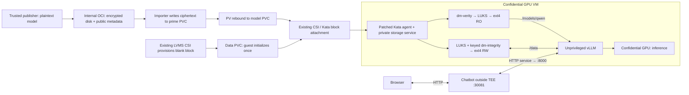
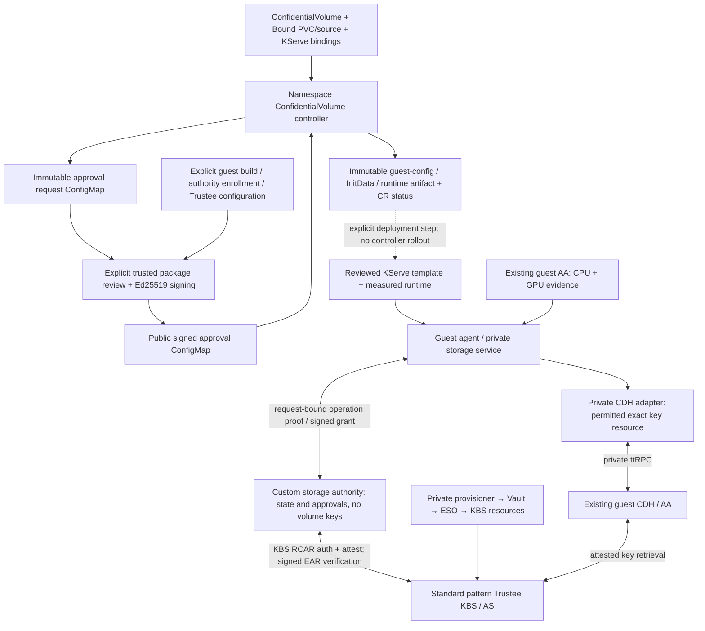

# Qwen confidential storage: implementation, workflow and integration gaps

**Implementation snapshot: 14 October 2026, validated workload revision v19.**
This describes the workload validated at `eb07abd` and the subsequently deployed
ConfidentialVolume controller at `018ae67`.
It is not a new live health check. Examples use the actual Qwen storage identities;
abridged examples are marked explicitly. No credentials are included.

## Summary to share

Qwen runs through KServe inside a confidential SEV-SNP GPU VM.
`/models/qwen` uses an OCI-populated, encrypted read-only PVC, protected by LUKS
and dm-verity. `/data` uses guest-initialized LUKS plus keyed dm-integrity, with
persistence verified across fresh VMs. The standard Validated Pattern Trustee
gates storage keys on CPU and GPU attestation and the approved guest/workload
identity. Real inference and chatbot tests passed; administrator `oc exec` is
denied by the measured agent policy.

The application runs as UID/GID 1001 with all capabilities dropped. It receives
filesystem mounts and the approved GPU devices, without raw storage devices,
storage keys or a privileged storage sidecar. The original Qwen service was
preserved. The separate chatbot is at `http://10.14.202.14:30081/` on the Red Hat
network/VPN; this endpoint currently uses HTTP.

This is a working custom integration. Its guest agent/storage service, storage
authority and model populator are additional implementation work. In particular,
the deployed `ConfidentialVolume` controller resolves declarations and workload
bindings, verifies a separately signed deployment approval, and publishes immutable
configuration and CR status. Trusted preparation, authority enrollment, guest
packaging and rollout remain explicit: applying declarations alone does not deploy
the solution. See the [baseline comparison](minimal-integration-and-stock-gaps.md)
for the precise CoCo/OSC changes and Validated Pattern integration gaps.

## The concrete workload

| Item | Validated configuration |
| --- | --- |
| Namespace / InferenceService | `confidential-storage-test` / `qwen-storage` |
| Serving mode | KServe Standard, one replica, Recreate updates |
| RuntimeClass | `kata-snp-nvidia-gpu-storage-candidate` |
| Guest / GPU | SEV-SNP, 8 vCPUs; NVIDIA RTX PRO 6000 Blackwell Server Edition at host PCI `0000:8c:00.0` |
| Application | `kserve-container`, vLLM serving `qwen3-0.6b` from `/models/qwen` |
| Model PVC | `qwen-luks-model-v1`, 2 GiB, Block, ReadWriteOncePod, `lvms-vg1` |
| Data PVC | `qwen-gpu-data-v1`, 1 GiB, Block, ReadWriteOncePod, `lvms-vg1` |
| Key resources | `kbs:///default/model-keys/qwen-gpu-model-v1` and `kbs:///default/model-keys/qwen-gpu-data-v1` |
| Storage authority | `storage-gpu-authority`, retained database on `storage-gpu-authority-state` |
| Chat → predictor | NodePort 30081 → chatbot → `qwen-storage-predictor:80` → vLLM port 8000 |

The `model-keys` segment is the existing KBS resource collection. A data key in
that collection remains a separate RW credential; collection names do not select
storage behavior. Likewise, `model` and `data` are binding IDs, not magic names.

## Which APIs describe what?

There are two custom resource types and ordinary Kubernetes PVCs:

| API | What it describes | Implementation status |
| --- | --- | --- |
| `EncryptedModelSource` | Immutable encrypted disk in OCI: repository, manifest digest, disk digest and size | CRD and custom populator deployed and exercised |
| `PersistentVolumeClaim` | Storage allocation and attachment; Block mode; optional population source | Existing Kubernetes/LVMS CSI, used unchanged |
| `ConfidentialVolume` | How a particular claim may be opened: profile, key reference, access and initialization | CRD, compiler and namespace controller deployed; signed configuration publication and status validated |
| Workload binding annotation | Which declaration goes to which container and destination | Discovered by the controller and bound to the approval request; enforced through measured guest configuration, not by the annotation alone |
| Authority record / authenticated manifest | Approval, current generation, disk identity, ownership and first-use history | Custom persistent authority, exercised live |

Both CRDs use `storage.confidentialcontainers.org/v1alpha1`, are namespaced and
have immutable specifications. These are prototype APIs in this repository, not
a claim of an upstream standardized API. Full schema definitions:

- [EncryptedModelSource CRD](../../charts/coco-supported/encrypted-model-populator/crds/encryptedmodelsources.yaml)
- [ConfidentialVolume CRD](../../charts/coco-supported/confidential-volumes/crds/confidentialvolumes.yaml)

The ConfidentialVolume schema requires `claimRef`, `access`, `profile`,
`initialization` and `keyResource`. It constrains RO to `luks-verity-v1` with
`Never` initialization and an approved content reference; RW uses
`luks-integrity-v1` with filesystem/owner fields. Its API validation is only the
first check: the compiler, trusted approval process and guest enforce additional
identity, geometry and lifecycle constraints.

### Read-only model: source and PVC

This source identifies the actual published encrypted Qwen image. The registry
origin is controller configuration, fixed to the internal OpenShift registry;
the CR cannot select an arbitrary external registry.

```yaml
apiVersion: storage.confidentialcontainers.org/v1alpha1
kind: EncryptedModelSource
metadata:
  name: qwen-luks-model-v1
  namespace: confidential-storage-test
spec:
  format: luks-verity-v1
  repository: confidential-storage-test/qwen-luks-e2e
  manifestDigest: sha256:49d4cc9827fc214fa339206c660656d8523dc8c2de1e95a9c1d9f7992934cd25
  diskDigest: sha256:c350a0f6ea363219ab750a3a3c7d309f7d35fc009b5171d417acde33c69fa8b7
  diskBytes: 2147483648
---
apiVersion: v1
kind: PersistentVolumeClaim
metadata:
  name: qwen-luks-model-v1
  namespace: confidential-storage-test
spec:
  storageClassName: lvms-vg1
  volumeMode: Block
  accessModes: [ReadWriteOncePod]
  resources:
    requests:
      storage: 2Gi
  dataSourceRef:
    apiGroup: storage.confidentialcontainers.org
    kind: EncryptedModelSource
    name: qwen-luks-model-v1
```

`ReadWriteOncePod` controls attachment exclusivity. It does **not** make the model
filesystem writable in the application: the workload requests read-only access,
and the guest enforces a read-only mapping and mount. The importer needs a writable
device while populating the claim. This implementation does not use ReadOnlyMany
or share the model PVC among multiple VMs.

The registered custom populator controller observes the PVC's `dataSourceRef`.
Using `lib-volume-populator`, it creates a temporary **prime PVC**. Existing CSI
allocates that disk; an importer pod writes only encrypted bytes from OCI, verifies
the pinned digests, flushes and reads back the disk. After success and importer
termination, the library rebinds the populated PV to the target claim. Reopening
this already populated, Bound claim does not rerun the importer.

The trusted publisher previously encrypted the model using its retained LUKS
credential. OCI contains a disk image and public metadata, never that credential.
The publisher handles plaintext; the registry, controller and importer do not need
the decryption key. The same credential is provisioned privately into Trustee.

### Read-write data: a new blank PVC

```yaml
apiVersion: v1
kind: PersistentVolumeClaim
metadata:
  name: qwen-gpu-data-v1
  namespace: confidential-storage-test
spec:
  storageClassName: lvms-vg1
  volumeMode: Block
  accessModes: [ReadWriteOncePod]
  resources:
    requests:
      storage: 1Gi
```

There is no `dataSourceRef`, so no model populator is involved. CSI supplies a raw
block allocation. Allocation or `Bound` status does not authorize formatting and
does not establish that its contents are blank. Trusted guest code must verify
the complete blank-device condition and the explicit first-use approval.

**The claim shown above is now initialized and contains data.** These manifests
document its creation; they are not instructions to delete/recreate or format it.
For another workload, use new claim names, capture their actual UIDs after
provisioning, and enroll a new logical RW volume with a separate credential.

### ConfidentialVolume declarations for these two claims

These specs match the installed `qwen-gpu-model` and `qwen-gpu-data`
ConfidentialVolume objects recorded in the [controller validation](../../tests/confidential-storage/evidence/2026-10-14/volume-controller/validation.json).
Server-generated metadata and status are omitted. The UIDs below identify the
existing claims; a new deployment must resolve its own UIDs.

```yaml
apiVersion: storage.confidentialcontainers.org/v1alpha1
kind: ConfidentialVolume
metadata:
  name: qwen-gpu-model
  namespace: confidential-storage-test
spec:
  claimRef:
    name: qwen-luks-model-v1
    uid: 997cefd0-0f9b-4325-b57e-b5220cc08d3e
  access: ReadOnly
  profile: luks-verity-v1
  initialization:
    policy: Never
  content:
    approvedManifestRef: qwen-luks-e2e-v1
  keyResource: kbs:///default/model-keys/qwen-gpu-model-v1
---
apiVersion: storage.confidentialcontainers.org/v1alpha1
kind: ConfidentialVolume
metadata:
  name: qwen-gpu-data
  namespace: confidential-storage-test
spec:
  claimRef:
    name: qwen-gpu-data-v1
    uid: 9bd3b354-b1f1-41a9-bd45-f13de5aec3ad
  access: ReadWrite
  profile: luks-integrity-v1
  initialization:
    policy: OnceIfApproved
    filesystem: ext4
    owner:
      uid: 1001
      gid: 1001
  keyResource: kbs:///default/model-keys/qwen-gpu-data-v1
```

`OnceIfApproved` means initialize only an independently approved new volume.
It never means format whenever a LUKS header is absent or unreadable. Ready volumes
only reopen; conflicting ownership, uncertain initialization and invalid headers
fail closed.

`approvedManifestRef` is a release-catalog identifier, not another CRD or a URL
the guest fetches. In this bounded preparer it is resolved from the reviewed
Qwen publisher evidence. A general catalog resolver is still missing.

PVC UID binding catches claim replacement in the configuration workflow. A UID
is not proof against a malicious host substituting disk contents: authenticated
header/content checks and authority state supply that additional boundary.

## Passing storage to KServe and into the application

This is an **abridged, non-deployable** excerpt of the Qwen predictor structure.
The real chart imports the reviewed `pod.json`, including the exact startup
program, image digest, environment, resource limits and measured InitData. Do not
replace that approved process with an arbitrary vLLM command and reuse its approval.

```yaml
apiVersion: serving.kserve.io/v1beta1
kind: InferenceService
metadata:
  name: qwen-storage
  namespace: confidential-storage-test
  annotations:
    serving.kserve.io/deploymentMode: Standard
spec:
  predictor:
    minReplicas: 1
    maxReplicas: 1
    deploymentStrategy:
      type: Recreate
    serviceAccountName: qwen-storage
    runtimeClassName: kata-snp-nvidia-gpu-storage-candidate
    automountServiceAccountToken: false
    labels:
      coco.io/skip-initdata: "true"
    annotations:
      storage.confidentialcontainers.org/bindings: |
        [
          {"volume":"model","confidentialVolume":"qwen-gpu-model","container":"kserve-container","mountPath":"/models/qwen"},
          {"volume":"data","confidentialVolume":"qwen-gpu-data","container":"kserve-container","mountPath":"/data"}
        ]
      io.katacontainers.config.hypervisor.cc_init_data: "<approved gzip/base64 InitData>"
    containers:
      - name: kserve-container
        image: nvcr.io/nvidia/vllm@sha256:15f380ad9c32f0ac57ac16e4b778c6f733c88b9ffe3a936035d0a59ad17b1aab
        # Exact measured command, environment and resources omitted.
        securityContext:
          runAsUser: 1001
          runAsGroup: 1001
          runAsNonRoot: true
          privileged: false
          allowPrivilegeEscalation: false
          readOnlyRootFilesystem: true
          capabilities:
            drop: [ALL]
        volumeDevices:
          - name: model
            devicePath: /dev/coco-volume-0
          - name: data
            devicePath: /dev/coco-volume-1
    volumes:
      - name: model
        persistentVolumeClaim:
          claimName: qwen-luks-model-v1
          readOnly: true
      - name: data
        persistentVolumeClaim:
          claimName: qwen-gpu-data-v1
          readOnly: false
```

The `skip-initdata` label preserves the explicitly prepared InitData from the
existing generation path; it does not disable measured policy enforcement.
The two `volumeDevices` entries carry raw block attachments through Kubernetes,
CSI and Kata. They are transport identifiers, not the device access ultimately
given to vLLM. The modified guest agent resolves their actual SCSI devices,
matches them to measured configuration and removes raw storage nodes/device
grants from the application's OCI specification before starting its process.

The private guest service opens the filesystems. The agent then supplies only
the approved directories at `/models/qwen` and `/data`. These are guest-created
mounts, not host-decrypted filesystem mounts or ordinary Kubernetes filesystem
`volumeMounts`. The separately validated NVIDIA CDI path supplies the GPU devices.

Both paths must activate successfully before the app starts. vLLM reads local
weights from `/models/qwen`; its writable home, temporary files and caches are
under `/data`. The startup program verifies model hashes and the persistent
canary, runs a CUDA probe and launches vLLM. `VLLM_USE_FLASHINFER_SAMPLER=0` keeps
the tested PyTorch sampling path compatible with `/data` mounted `noexec`.

## Data paths and trust boundaries

The controller/approval path carries public configuration. It does not carry model
bytes, application writes or decryption credentials. These are separate paths:

| Path | Actual route | Where plaintext or keys exist |
| --- | --- | --- |
| Model publication | Trusted publisher → encrypted LUKS disk + verity tree → internal OCI registry | Publisher sees plaintext and the LUKS unlock credential; registry holds ciphertext and public metadata |
| Model population | Registry → importer → temporary prime PVC → populated `qwen-luks-model-v1` | Controller/importer need registry access, not the model decryption credential; CSI and storage see encrypted disk bytes |
| Model consumption | Block PVC → Kata-attached guest device → dm-verity → read-only LUKS/dm-crypt → ext4 → `/models/qwen` → vLLM → confidential GPU | Decryption occurs in guest infrastructure; weights are plaintext in protected guest/GPU memory while used |
| Writable application data | vLLM `/data` ↔ guest ext4 ↔ LUKS/dm-crypt with keyed dm-integrity ↔ attached block PVC | Plaintext inside the guest; persistent backing storage contains encrypted data, integrity tags and public layout metadata |
| Storage credentials | Private provisioning → Vault/ESO → standard Trustee KBS resource → attested CDH → private guest adapter/storage code → device mapper | Provisioning/Trustee are trusted key holders; no volume key in CRs, ConfigMaps, registry, populator or vLLM |
| Prompts and responses | Browser → HTTP NodePort 30081 → ordinary chatbot pod → HTTP predictor service → vLLM in the VM | Chatbot and network path are outside the TEE; this demo does not provide client-to-TEE TLS |

The RO artifact is a model **disk image** distributed through OCI, separate from
the digest-pinned vLLM **container image**. The populator copies the encrypted disk;
it does not launch vLLM or decrypt weights. Kubernetes uses Block PVCs to transport
devices; our guest agent turns their approved contents into filesystem mounts.



The RO read order above matters: the approved verity root authenticates the LUKS
header and encrypted data **before** the LUKS mapping is opened. For RW storage,
first use performs the approved format/integrity/filesystem operations inside the
guest. Later VMs reopen the existing volume; they do not use the populator or
repeat formatting. Both profiles mount `nodev,nosuid,noexec`; the model also uses
`ro,noload`. Storage-side encryption does not make the HTTP inference path private.

## Configuration, attestation and key paths



There are three distinct decisions:

1. **Deployment approval:** a separate signer approves a public package for an
   exact controller request, workload incarnation and cluster identity. The
   controller checks its signature, expiry, hashes and binding consistency, then
   publishes `guest-config.json`, `initdata.toml` and `runtime.json` with the
   request/approval. It does not hold that signing key or storage credentials.
2. **Storage lifecycle authorization:** the custom authority approves model
   release/ownership and RW first-use/reopen operations. Its standard Trustee
   adapter authenticates a fresh request using CPU/GPU evidence and a guest proof.
   It returns a signed operation grant, never a volume key.
3. **Key release:** the existing KBS resource policy requires CPU/GPU attestation
   and the approved guest launch/InitData identity. Private CDH retrieves the
   specific allowed credential; measured guest code also enforces the authority
   grant. KBS does not interpret the ConfidentialVolume CR or its `Approved` status.

The model credential originates at trusted publication; the separate RW credential
is privately provisioned before first guest initialization. These are LUKS unlock
credentials, not an assertion that all internal LUKS volume keys are identical to
those bytes. Vault/ESO and Trustee are part of the trusted provisioning domain.

The controller was added **after** the successful Qwen v19 rollout. The validation
matched and signed the already deployed configuration, then reconciled the two
real declarations. It did not build or redeploy that guest. Both declarations
reached `Approved` in the retained test; a tampered approval signature produced
`Blocked`, and restoring the approval restored publication. A controller restart
preserved the immutable artifacts. The lab approval lasts 24 hours: expiration
withdraws approval status, not a running VM or previously released keys.

`Approved` means configuration provenance, **not** a mounted-filesystem readiness
signal. The controller has no workload-write, key-read or formatting permissions.
See [controller behavior and validation](confidential-volume-controller.md).

### Preparing storage for a new workload

1. **Prepare or select an approved immutable model release.** A trusted publisher
   builds the encrypted LUKS disk and verity tree; publish ciphertext into OCI.
   Retain its credential privately and its complete public manifest for review.
   An existing encrypted artifact can be imported into another claim without
   re-encrypting it, but its use still needs a matching approval and key policy.
2. **Provision the claims.** Create the model source and model PVC; wait for
   population. Create a separate blank RW PVC without a population source.
   Capture actual claim UIDs. The tested backend supports a 2 GiB Qwen model
   image and a 1 GiB RW profile; larger/other RW layouts need implementation work.
3. **Describe the intended use.** Create ConfidentialVolume objects and bindings
   to a specific consumer and paths. The namespace controller resolves actual
   claim/source/workload identities and runs the deterministic compiler, supporting
   up to eight distinct volumes for one consumer. It rejects conflicting paths,
   duplicate identities and unsupported attachments, then publishes an immutable
   approval request. That request is not permission to open disks.
4. **Approve and enroll.** Trusted preparation resolves exact versioned profile
   hashes and model manifests, registers authority records and explicitly approves
   first initialization of the new logical RW volume. Generate/retain its separate
   credential. Populate standard Trustee resources through the existing private
   Vault/ESO path. The authority has signing/TLS credentials but no volume keys.
5. **Package and measure.** The current preparer emits public service configuration,
   agent policy and InitData. Service configuration is embedded in the measured
   guest; InitData includes the contract, policy and AA/CDH settings. Independently
   calculate the guest launch measurement and approve exact launch/InitData values
   in the two scoped Trustee bindings. This workload-specific guest packaging is
   an integration limitation. Sign the reviewed package against the controller
   request and publish the public approval. The controller verifies it, publishes
   the immutable configuration artifact and updates conditions. It does not enroll
   the authority or change Trustee policies itself.
6. **Deploy the reviewed predictor template.** KServe creates the pod; existing
   CSI/Kata attach both devices. Runtime launches the approved SEV-SNP guest and
   passes the allocated GPU. The original Qwen runtime is left intact.
7. **Authenticate, activate, then start.** Trusted guest code obtains authority
   decisions backed by fresh CPU/GPU appraisal and retrieves the permitted
   credentials through private CDH. Open RO storage; initialize or reopen RW
   storage; expose the approved mounts only when every binding succeeds.
8. **Validate and retain.** Verify hashes, write/fsync a canary, run GPU inference,
   close the consumer cleanly, boot a fresh VM and verify the same canary. Retain
   credentials, approvals and authority history. Never recreate authority state
   or reformat a used disk as a shortcut to redeployment.

The workload-specific preparation tool used for the original rollout is
[`gpu-guest/prepare.py`](../../tests/confidential-storage/gpu-guest/prepare.py).
It requires an explicit new data PVC UID and a fresh private output directory.
It is deliberately unsuitable for recovering or updating used storage. The
[candidate runbook](gpu-guest-candidate.md) covers measured workload upgrades:
they retain original initialization identity, disk keys and journal while changing
the approved current workload identity.

### First RW use versus a later VM

| Phase | First approved use | Fresh VM using existing storage |
| --- | --- | --- |
| Authority | Registered new volume, explicit initialization approval, no conflicting owner | Ready record and cleanly released previous owner |
| Disk checks | Exact size/profile and complete blank scan | Authenticated header, geometry, manifest and existing initialization journal |
| Operations | Journal `luks-format`, `integrity-initialize`, `filesystem-create`, `durability-barrier` | Reopen existing encrypted mapping and ext4; no formatting |
| Keys and identity | New retained RW credential and enrolled disk identity | Same credential and disk identity; current approved workload policy |
| Application | Receives mounted `/data` after Ready and ordinary reopen authorization | Receives mounted `/data` with previous contents |
| Failure | Uncertain effects retain ownership for explicit recovery | Conflicting/stale ownership denies reopen; elapsed time does not permit takeover |

Fresh-VM persistence was demonstrated after clean ownership closure. Arbitrary
crash recovery and safe automatic failover are separate gaps; the example uses
one replica and Recreate to avoid concurrent writers.

## What protects the data?

| Mechanism | RO model | RW data | Limit |
| --- | --- | --- | --- |
| LUKS2 + dm-crypt | Encrypted model filesystem, read-only mapping | Encrypted writable filesystem | Encryption alone does not authenticate disk contents |
| dm-verity | Approved SHA-256 root covers LUKS header and ciphertext; guest opens verity before LUKS | Not used on mutable data | A valid old root needs release freshness policy to reject rollback |
| dm-integrity with keyed HMAC-SHA256 | Not needed for this immutable profile | Authenticated sectors and integrity journal | Does not prevent replay of previously valid sectors or a consistent old snapshot |
| Authenticated manifests and strict header checks | Bind release, geometry, header, key resource and verity root | Bind enrolled header/profile and initialization identity | Host-provided YAML or a LUKS header checksum alone is not authority |
| Trustee attestation policy | CPU + GPU evidence and exact launch/InitData bindings gate key | Same, separate credential | Does not itself implement storage ownership or RW sector freshness |
| Storage authority | Current approved release/generation and ownership | Ownership, first-use journal, policy history and Ready state | Its retained history must be protected from rollback in production |

Storage hardware is treated as an untrusted source of ciphertext. The design
does not require attesting the disk/controller to keep plaintext and keys within
the trusted publisher/guest/services. A malicious storage backend can still
withhold data, destroy it or replay old valid data. RO release approval can reject
retired model generations; general RW rollback protection needs an additional
freshness design. dm-integrity is not that design.

The lab authority and Trustee run in the same administrative cluster. The
authority's PVC proves persistence across process restarts, not protection from
a hostile cluster administrator restoring old authority state. Production needs
a trusted state service outside that rollback domain. This also matters for
enforcing model-generation freshness.

## Components: additions, changes and reuse

The deployed Qwen path below uses our agent patch. A separate
[stock-agent sidecar experiment](stock-agent-sidecar-experiment.md) demonstrates
an alternative mount-delivery mechanism; it has a narrower validation scope.

| Component / source | What we implemented or configured | Where it runs / privilege |
| --- | --- | --- |
| [Model publisher and populator](../../components/encrypted-model-populator/) | Encrypted Qwen disk packaging, OCI digest verification, custom source API, prime-PVC import/rebind; small namespace-colocation extension to vendored `lib-volume-populator` v3.2.0 | Trusted publisher handles plaintext; controller moves metadata; importer writes ciphertext as UID 0 with no added capabilities and `privileged: false` |
| [Volume compiler](../../components/confidential-volume-contract/), [controller](../../components/confidential-volume-controller/) and [chart/CRD](../../charts/coco-supported/confidential-volumes/) | Immutable declarations, identity resolution, deterministic approval requests, Ed25519 approval verification, immutable artifacts and status | Separate namespace-scoped controller; public configuration only, no key access or workload writes |
| [Native Kata agent integration](../../components/confidential-storage-kata/native-agent/) | Lifecycle hooks, binding/device admission, `activate-many`/close calls, mount insertion, raw storage removal and bounded guest-generated NVIDIA CDI compatibility | Trusted root infrastructure inside the VM; patched agent built against pinned downstream Kata 3.31.0 |
| [Private storage service](../../components/confidential-storage-service/) and [storage backend](../../components/confidential-storage-guest/) | Multi-volume activation, LUKS/verity/integrity operations, header verification, initialization journal, cleanup and mounts | Root guest daemon; private socket, not an application container/sidecar |
| [Private CDH adapter](../../components/confidential-storage-kbs/src/private_cdh.rs) | Checks authority-derived permits, restricts resource URIs, retrieves credential over private CDH ttRPC, decodes explicit hex/raw representation | Guest trusted code; existing CDH binary reused |
| [Authority client](../../components/confidential-storage-client/) and [authority](../../components/confidential-storage-authority/) | Fresh request authentication through standard KBS RCAR, signed receipts, model approval, ownership, durable initialization and policy-upgrade history | Guest client plus separate restricted cluster service; retained DB, no volume keys |
| [Guest assembly](../../tests/confidential-storage/native-guest/build.py) | New agent/service/config, storage tools/libraries and matching dm-integrity dependencies | Measured initrd; installed AA, CDH and NVIDIA stack preserved |
| RuntimeClass / isolated handler | Point test handler to hash-identified combined GPU/storage guest | Host configuration only; no QEMU, CRI-O, CSI or Kata shim source change for this path |
| [Trustee policy override](../../overrides/values-trustee-gpu-model-keys.yaml) | Separate model/data resources and exact guest launch/InitData bindings, existing CPU/GPU policy retained | Standard pattern Trustee, RVPS and Vault/ESO; no Trustee server source fork |
| [KServe chart](../../tests/confidential-storage/gpu-guest/chart/templates/kserve.yaml) and [identity](../../tests/confidential-storage/gpu-guest/chart/templates/kserve-identity.yaml) | Reviewed pod template, one replica/Recreate, dedicated SA and narrowly scoped UID-1001 SCC | Existing KServe; app has no capabilities, host access or API token |
| [Chatbot chart](../../charts/coco-supported/qwen-chat/) | Configurable model/backend, separate NodePort 30081 | Ordinary restricted pod outside the confidential VM |

The CDH adapter and Trustee adapter serve different purposes. **CDH retrieves a
storage credential.** The **Trustee/RCAR adapter authenticates an authority
operation** using fresh hardware evidence, a request-bound challenge and a guest
signature. The authority does not fetch keys. The signed operation grant is
enforced by the measured guest storage code; it is not a new KBS plugin.

The installed Trustee EAR format required an explicit compatibility profile:
pinned signer, expected absence of `iss`, signed NVIDIA nonce-match/security
claims and the CPU composite report-data binding. No missing-claim fallback was
enabled. See the [live candidate details](gpu-guest-candidate.md) for the verified
profile; earlier adapter design notes describe the stricter source-default mode.
CDH may reuse an attestation session for resource retrieval, so “every key read
performs a brand-new CPU/GPU attestation” is not a demonstrated property.

## Gaps to integrate into the existing toolchain

The [component-by-component baseline comparison](minimal-integration-and-stock-gaps.md)
separates missing Validated Pattern integration from our remaining prototype limits.
The comparison is against the inspected installed stack and the documented OSC
1.13 recipe, not an assertion that every upstream project lacks these features.
The installed baseline was recorded as OSC 1.13.0. The current
[OSC 1.13 block-volume guide](https://docs.redhat.com/en/documentation/openshift_sandboxed_containers/1.13/html/deploying_confidential_containers_on_bare-metal_servers/configure-cc-overview_metal-cc)
already documents raw-block LUKS storage and Trustee-provided sealed passphrases.
Its example uses `osc-storage-helper:1.13.1`, privileged helper/application
containers, a shared process namespace and a postStart hook. Our contribution is
guest-managed activation for an unprivileged app plus the release/initialization
controls described here. We did not test that stock helper in this GPU workload.

| Gap | What works today | Integration work / likely owner | Acceptance condition |
| --- | --- | --- | --- |
| Reconciliation-to-deployment integration | CRD/compiler/controller deployed; request, signed approval, immutable artifact and conditions validated | Integrate existing chart with pattern installation and reviewed package/enrollment/rollout workflow | Supported workload setup consumes the published artifact without manual copying; status remains distinct from runtime readiness |
| Independent approval | Explicit trusted preparation resolves publisher metadata and enrolls records | Define release/initialization approval API, trust ownership and authorization; keep signer away from untrusted controller | Altered CRs cannot self-approve keys, formatting, paths or model generations |
| Generic guest configuration delivery | Public storage config embedded in measured workload-specific initrd; contract also in InitData | Define authenticated generic config delivery through supported InitData/CDH/Kata interfaces | Add supported volumes without rebuilding a workload-specific guest while preserving all bindings and key policy checks |
| Kata lifecycle integration | Native agent patch works with real GPU and two disks | Upstream/rebase device resolution, storage activation, mount publication and cleanup hooks; agree guest-service boundary | Supported Kata build passes RO/RW/GPU, negative admission and lifecycle tests without local overlay patches |
| Guest packaging | Installed GPU base extended with service/tools and matching dm-integrity modules | Package maintained service, device-mapper/filesystem dependencies, sockets and startup ordering in OSC/CoCo images | Reproducible supported guest image and measurement/reference update process |
| AA/CDH/Trustee interface compatibility | Existing servers unchanged; private adapters and explicit installed-EAR profile work | Stabilize supported operation-proof and composite-evidence contracts, session lifetime and resource policy integration | Versioned compatibility tests pass across supported Trustee/guest upgrades; no silent weaker fallback |
| Storage authority durability and trust | Restricted custom service, retained DB and policy history | Decide service ownership, HA, external trusted state, backups and secure restore | Host rollback cannot undo accepted generation, ownership or initialization history |
| Crash recovery and fencing | Clean close/reopen works; uncertain effects stay fenced; recovery only for provably unstarted initialization | Implement reviewed recovery for lost guests, partial formatting, ambiguous acknowledgments and failed cleanup | Failure injection cannot produce two owners, format used media or erase history |
| RW freshness | Keyed integrity rejects unauthenticated modification | Design application/storage freshness if old valid writes/snapshots must be rejected | Previously accepted but stale state is rejected using trusted external freshness, beyond dm-integrity |
| General profiles and capacity | Tested 1 GiB RW/ext4/1001:1001; 2 GiB model; bounded 1–8 bindings, live pair | Add supported sizes/layouts, quota/capacity reporting and profile migration; these are our prototype limits | Several sizes and approved owners pass initialization, reopen and failure tests |
| Sharing and scaling | Exclusive RWOP claims, one app container/replica | Define immutable model sharing, multi-container lifecycle, multi-node scheduling and independent RW volumes per replica | Multiple consumers cannot inherit another writer's authority or private data |
| Populator productization | Custom controller and actual OCI import work | Package/operator lifecycle, review local library extension, namespace/registry RBAC and OpenShift support matrix | Supported installation/recovery/upgrade; already populated claims never get rewritten |
| Key lifecycle | Separate retained credentials in standard Vault/ESO/Trustee; exact scoped policy | Add reviewed rotation, adoption, revocation and backup/restore transitions | Rotation preserves disk access/history; old authorization cannot reopen retired identities |
| Serving and policy tooling | KServe renders an exact reviewed process; custom narrow SCC and measured environment | Integrate with normal policy generation and KServe mutation handling, remove workload-specific assumptions | Supported rollout updates policy without broad environment/device permissions or storage reset |
| Transport protection | Real HTTP chat/inference proven | Implement TLS to the required trust boundary; TLS in the VM if host-visible plaintext prompts are excluded | Trace client-to-TEE TLS termination and verify no outside proxy receives plaintext |

No custom CSI driver was required: CSI remains responsible for ciphertext
provisioning and block attachment. A future CSI integration could automate
additional lifecycle interfaces, but it cannot replace the trusted guest opener,
attestation policy or durable authority decisions.

The declaration/approval reconciler now exists. The remaining gaps above are
packaging, supported guest interfaces, trusted enrollment and operational coverage.
They should not be read as a claim that another controller must be implemented
before the existing RO/RW example works. Distribution and key release already use
the existing CSI, registry and standard Trustee.

## Evidence and limits of the result

The final startup log includes:

```text
STORAGE_MODEL_RO_HASHES_PASS
STORAGE_DATA_REOPEN_PASS
CUDA_GPU_PROBE_PASS
Model loading took 1.1201 GiB
Available KV cache memory: 22.37 GiB
Application startup complete.
```

| Claim | Evidence |
| --- | --- |
| Published model artifact and source | [OCI source digests](../../tests/confidential-storage/evidence/2026-10-13/model-populator/source.json) |
| GPU, model verification and data reopen | [v19 startup log](../../tests/confidential-storage/evidence/2026-10-14/gpu-live-bringup/kserve-startup-v19.log) |
| Real model response | [Inference HTTP 200: “2 plus 2 equals 4.”](../../tests/confidential-storage/evidence/2026-10-14/gpu-live-bringup/inference-v19.txt) |
| Browser-facing service reaches this exact model | [Unique chat marker, endpoint/UID trace and increasing vLLM success counter](../../tests/confidential-storage/evidence/2026-10-14/gpu-live-bringup/chat-audit-v19.json) |
| Actual SNP VM and GPU mapping | [KServe pod → QEMU → VFIO mapping](../../tests/confidential-storage/evidence/2026-10-14/gpu-live-bringup/kserve-vm-v19.json) and [launch verification](../../tests/confidential-storage/evidence/2026-10-14/gpu-live-bringup/live-launch-v19.json) |
| Completed first-use history retained under current policy | [Two Ready records, active ownership and four Complete RW steps](../../tests/confidential-storage/evidence/2026-10-14/gpu-live-bringup/authority-state-v19.json) |
| Application privileges and exec denial | [SCC/identity validation](../../tests/confidential-storage/evidence/2026-10-14/gpu-live-bringup/service-account-scc-v19.json) and [validation progress](../../tests/confidential-storage/evidence/2026-10-14/gpu-live-bringup/progress.json) |
| Controller reconciliation and immutable publication | [Controller validation, deployed image and actual CR specs/status](../../tests/confidential-storage/evidence/2026-10-14/volume-controller/validation.json) |
| Invalid deployment approval rejected | [Signature denial and restoration](../../tests/confidential-storage/evidence/2026-10-14/volume-controller/signature-denial.json) |
| Original service preserved | [Original pod identities, zero restarts and endpoint checks](../../tests/confidential-storage/evidence/2026-10-14/gpu-live-bringup/preserved-original-v19.json) |

Unit and policy denial tests supplement the hardware E2E; they are not all live
attack demonstrations. No claim is made here of generic crash-safe failover,
arbitrary RW rollback resistance, shared model PVCs, image signature verification
or end-to-end TLS. Digest-pinned images and measured agent policy are the enforced
image/process controls in this example.
