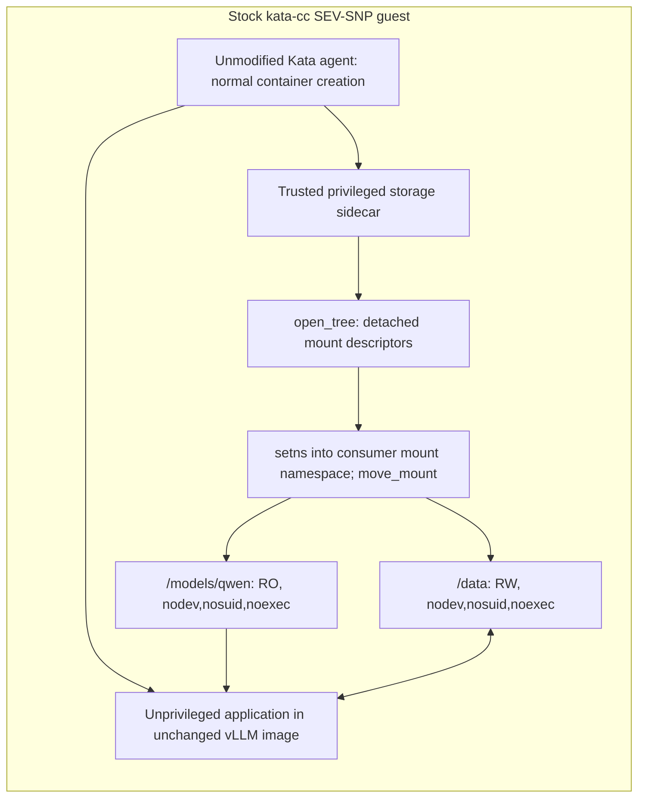

# Stock Kata agent with a privileged storage sidecar

**14 October 2026: isolated feasibility experiment.** The existing Qwen services
were preserved. This tests an alternative to the patched-agent path; it does not
replace that deployment or inherit its attestation/storage validation results.

## What the test establishes

A privileged sidecar can give RO and RW filesystem mounts to an unprivileged
container in the **same confidential VM**, using the unchanged stock Kata agent.
Both containers use the exact NVIDIA vLLM image digest used by Qwen. The application
runs a diagnostic program, not the vLLM inference server; no GPU is allocated.

The passing mount test records:

- Application UID/GID 1001, `CapEff=0`, `NoNewPrivs=1`, read-only container rootfs.
- Readable `/models/qwen`, with writes rejected by `EROFS`.
- Writable `/data`, with successful write, fsync and readback visible to the helper.
- No application access to the helper's private key file or device-mapper node.
- Clean removal of injected mounts while the application is alive, verified from
  both containers.

See the [application log](../../tests/confidential-storage/evidence/2026-10-14/stock-agent-sidecar/mount-application.log),
[sidecar log](../../tests/confidential-storage/evidence/2026-10-14/stock-agent-sidecar/mount-sidecar.log)
and [stock runtime/image/agent fingerprints](../../tests/confidential-storage/evidence/2026-10-14/stock-agent-sidecar/mount-validation.json).

## Encrypted follow-up

The follow-up passed with two newly created **128 MiB RAM-backed disk images**,
an ephemeral 32-byte test credential and synthetic contents. The sidecar:

- Creates an ext4 model disk inside LUKS, closes it, builds a dm-verity tree over
  the encrypted image, then opens verity → read-only LUKS → ext4 `ro,noload`.
- Creates LUKS2 with `hmac-sha256` dm-integrity and an ext4 RW filesystem owned
  by UID/GID 1001.
- Transfers both mounts to the unprivileged application using detached mounts.
- Verifies the application's fsynced canary, removes its mounts, closes/reopens
  the RW mapping, verifies the canary again, and closes all mappings.

The original guest image and agent remain byte-for-byte unchanged. The helper
brings cryptsetup/verity/integrity userspace tools and **loads the matching signed
`xor`, `async_tx`, `async_xor`, `dm-integrity` modules into this guest kernel**.
This requires module-loading privileges in the helper; it does not mean the
stock guest already contains every dependency. Guest-local loop and mapper nodes
are created in the helper's `/dev`; they are not granted to the application.

The diagnostic tools are served as public bytes by a restricted, cluster-local
HTTP pod and verified against a pinned bundle SHA-256 before use. That is test
scaffolding; a maintained helper image should package these dependencies.
No real model, production key or existing disk is used. Reopen is within the
same VM; **fresh-VM PVC persistence and attested key retrieval are not tested by
this experiment**. See the [encrypted sidecar log](../../tests/confidential-storage/evidence/2026-10-14/stock-agent-sidecar/encrypted-sidecar.log)
and [unprivileged consumer log](../../tests/confidential-storage/evidence/2026-10-14/stock-agent-sidecar/encrypted-application.log),
with [final validation and executed-program hashes](../../tests/confidential-storage/evidence/2026-10-14/stock-agent-sidecar/encrypted-validation.json).
The final formatted chart/scripts passed in `stock-agent-sidecar-encrypted-final`.

## How mounts cross the container boundary

The pod enables `shareProcessNamespace`, not host PID access. The helper locates
the diagnostic consumer and opens its mount namespace and root. It clones each
source mount using `open_tree(OPEN_TREE_CLONE)`, enters the consumer namespace,
then attaches the detached mount using `move_mount(MOVE_MOUNT_F_EMPTY_PATH)`.
Only the helper performs privileged syscalls. The application waits for both
mounts before using them.

A conventional bind mount from `/proc/<helper-pid>/root/...` failed with `EINVAL`
after entering the consumer namespace. Detached mounts solved that observed
cross-namespace source problem. The Linux APIs are documented in
[open_tree(2)](https://man7.org/linux/man-pages/man2/open_tree.2.html) and
[move_mount(2)](https://man7.org/linux/man-pages/man2/move_mount.2.html).

The mount destinations start as empty guest-memory volumes. There is no hostPath,
host mount propagation or host-decrypted filesystem. The source filesystems in
the first probe are private guest tmpfs mounts. This first result is a mount and
privilege test, not persistent encrypted-storage evidence.

## What stayed unchanged

| Item | Observation |
| --- | --- |
| Kata agent | Stock binary SHA-256 `7592b09b0a8e57837f47c46f03d4844d1a010d30d469dcd11df99fdd22b2e6d4` |
| Guest initrd/kernel | Original `kata-cc` artifacts; no guest-image rebuild or agent patch |
| Host runtime configuration | No handler changes, CRI-O reload/restart or node reboot |
| vLLM image | Same digest as current Qwen; only the test command differs |
| Existing workloads | [Qwen/chat pod identities, readiness and restart counts unchanged](../../tests/confidential-storage/evidence/2026-10-14/stock-agent-sidecar/preserved-workloads.json) |
| Trustee and production keys | No changes or key requests; test InitData points KBS to an unreachable endpoint |

The stock CPU runtime's initial 60-second create timeout interrupted the large
image pull. The test uses the existing per-pod
`io.katacontainers.config.runtime.create_container_timeout: "300"` annotation,
four vCPUs and 64 GiB guest RAM. These are pod configuration, not Kata source or
shared runtime changes. A dedicated SCC is pinned to the test pod; the helper is
privileged and the application explicitly drops every capability.

## What this changes about the integration options

The agent patch is **not required merely to make sidecar-created mounts visible
to an unprivileged consumer on this kernel**. The sidecar can implement that
mechanism. Our patched-agent deployment additionally enforces admission rules,
private service access, exact bindings and lifecycle ordering. Those guarantees
do not automatically follow from this experiment.

Before using the sidecar for the real Qwen storage path, it still needs:

1. The authenticated volume contract, approved model identity and authority
   lifecycle protocol, rather than the diagnostic PID/success-file exchange.
2. Tested private access to AA/CDH and Trustee credentials, with key APIs and keys
   inaccessible to the application. A shared pod network alone is not that boundary.
3. A measured/policy-approved helper image and strict container/device/mount policy.
   The no-key diagnostic policy used here is deliberately broader.
4. A trusted application startup gate and cleanup/recovery for crashes and restarts,
   with ownership retained when side effects are uncertain.
5. Tests with fresh dedicated Block PVCs, OCI population, real key release and a
   separate GPU inference workload. Both existing GPUs remain allocated to Qwen.

The populator, ConfidentialVolume controller and external storage authority remain
separate components. Moving guest storage code into a sidecar does not replace
them. A helper is still trusted privileged infrastructure inside the TEE, even
though the application remains unprivileged.

## Reproduce

The [probe README and Helm chart](../../tests/confidential-storage/stock-agent-sidecar/README.md)
contain the exact scripts, namespace guard, dedicated SCC and commands. The test
namespace is `confidential-sidecar-test`. Do not give this diagnostic policy real
storage credentials or attach existing used claims.

After validation, the temporary tool server/service and dedicated test
SCC/RBAC/service account were removed. Completed probe pods and committed logs
remain for inspection; rerunning requires the documented bootstrap step.
