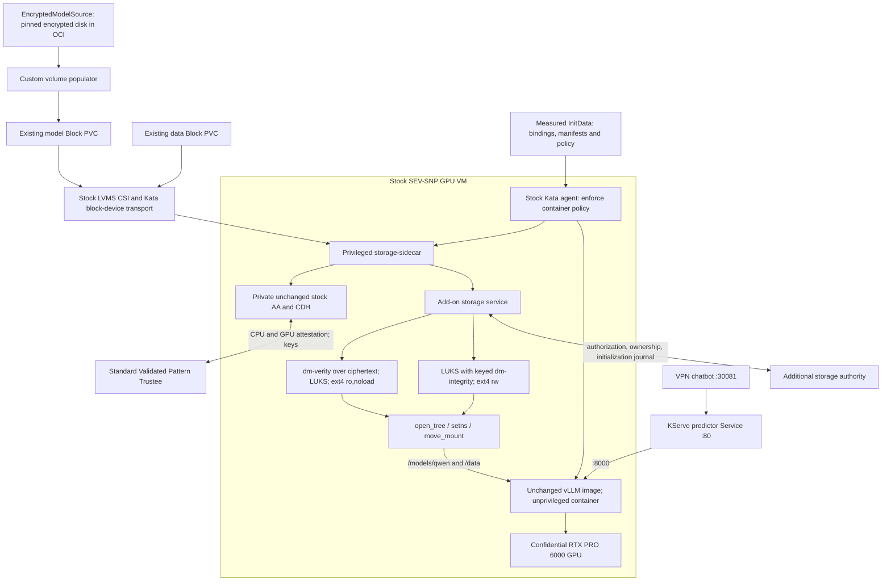

# Qwen storage add-on with stock Kata

The separate `confidential-storage-test/qwen-storage` workload now uses the stock
`kata-cc-nvidia-gpu` RuntimeClass and the original NVIDIA vLLM image. A privileged
storage helper runs in the same SEV-SNP VM; vLLM remains UID/GID 1001, drops all
capabilities, has `NoNewPrivs` and a read-only root filesystem. The helper is part
of the trusted guest computing base. This removes the Kata patch requirement,
not the need for privileged storage management inside the guest.

The original `gpu-workload/encrypted-qwen` and its chatbot on port 30080 were
preserved. The migrated workload uses the existing chatbot on port **30081**.
The VPN endpoint is HTTP; this change does not add end-to-end TLS.

## Data and control paths

The model remains the already populated `qwen-luks-model-v1` 2 GiB Block PVC.
The encrypted disk was distributed through the internal OCI registry and the
existing custom volume populator. Migration does not repopulate that bound claim.
The data volume remains `qwen-gpu-data-v1`, a 1 GiB Block PVC, with its original
LUKS header, key, filesystem, generation and initialization journal.

The sidecar receives the two raw devices. The application receives only guest
memory placeholders at `/models/qwen` and `/data`, plus `/dev/shm` and a rendezvous
socket. Once storage is authorized and opened, the helper attaches the filesystems
into the application's mount namespace and enforces `nodev,nosuid,noexec` and the
appropriate RO/RW flag. There is no host-decrypted filesystem or host mount
propagation. The helper authenticates the application with `SO_PEERCRED`, its
measured command, UID/GID, capabilities and `NoNewPrivs`; pidfds and opened namespace
and root descriptors pin that consumer across mount transfer and teardown.

The unchanged AA/CDH executables and their libraries are packaged from the pinned
stock GPU initrd. Their private Unix sockets live only in the helper. The supported
guest-components boot parameter disables the guest REST endpoint, and startup
refuses a listening port 8006. AA starts after GPU attachment and checks the supplied
InitData against SNP HOST_DATA. Trustee release rules bind both storage keys to
the approved launch measurement and InitData, in addition to CPU/GPU appraisal.
The storage authority adds retained ownership and manifest/initialization decisions;
it does not replace Trustee or issue an unattested key bypass.

## What was added or changed

| Component | Current role / change |
| --- | --- |
| Kata runtime, agent, kernel, GPU initrd | Stock installed artifacts; no replacement, patch, CRI-O restart or custom handler |
| vLLM image | Original pinned image; reviewed startup command waits for mounts, validates model hashes/data canary and CUDA, then execs vLLM |
| Storage helper image | New add-on supervisor; cryptsetup, filesystem tools and matching signed guest integrity modules; private copies of unchanged stock AA/CDH |
| Existing add-on storage service | Added optional `--sidecar-parent` peer check; default agent-integrated mode remains available; built with `trustee-rcar` |
| Kubernetes security configuration | Dedicated service account/SCC plus admission guard limiting namespace, stock runtime, images, claims and application privileges |
| KServe InferenceService | Original primary container plus helper; shared guest PID namespace, memory mount targets, raw devices only on helper; same service/chat route |
| Trustee configuration | Only the two storage-key identity bindings updated; ordinary CPU/GPU policies and original Qwen keys retained |
| Existing storage authority | Same service and retained DB; explicit policy migration, existing disk identity/history preserved |
| Model populator and CRDs | Existing custom add-ons retained; no storage CSI modification |
| Recovery tooling | Offline, administrator-only fenced Ready-reopen recovery; exact-record comparison, permanent session retirement and audit event; no HTTP takeover API |

See the executable [component implementation](../../components/confidential-storage-sidecar/)
and [rendered Qwen example and public inputs](../../tests/confidential-storage/stock-agent-sidecar/qwen-example/).
The example includes complete KServe/ConfigMap objects and the admission chart values.

## Shutdown and failure handling

Stock Kata sends stop signals to **every process in a container's cgroup**. The
first real restart test exposed this: the helper's AA/CDH/storage-service children
were terminated before volume closure. Inference had passed, but the authority
correctly retained ownership and denied the replacement VM. This failed restart
is recorded separately; it is not reported as a persistence success.

The corrected add-on installs its own signal handlers early and blocks TERM/INT
in private child processes before exec. The supervisor stops the application and
remaining namespace workers, removes transferred mounts, closes filesystem/device
mappings, releases authority ownership, then kills its private children. Stock Kata
remains unchanged. A Linux subprocess regression verifies that a private child can
finish its cleanup exchange after a container-wide TERM.

After the interrupted test, the lab administrator verified the old sandbox and
sidecar VM were gone. The offline recovery tool retired exactly the two unchanged
Ready/reopen sessions and preserved disk identities and all initialization history.
This is an explicit trusted-lab recovery operation: a host inventory or an evidence
hash is **not** cryptographic fencing against a malicious host. Production recovery
requires an independent fencing mechanism. Never release ownership merely because
a timeout expired, restore an old authority DB, or reformat a disk to recover it.

## Verification and limits

Live evidence is collected under
[`stock-qwen-sidecar`](../../tests/confidential-storage/evidence/2026-10-14/stock-qwen-sidecar/).
**The corrected v11 add-on passed the live test, including a fresh-VM restart.**
Both real PVCs mounted, all model-file hashes and the existing data canary passed,
CUDA executed on the RTX PRO 6000, and chatbot requests incremented vLLM's success
counter before and after replacement. Administrator exec was denied in both containers.

| Check | Recorded result |
| --- | --- |
| Stock runtime / agent / boot artifacts | Stock `kata-cc-nvidia-gpu`; original initrd/kernel/OVMF hashes and expected command line verified |
| Trustee appraisal | CPU and GPU `affirming`, hardware 2, configuration 3, executables 3 |
| Clean shutdown | Mounts removed at 17:41:42 UTC; `SIDECAR_STORAGE_CLOSED` at 17:41:43 UTC |
| Authority transition | Both owners cleared, then two new reopen events; generation 1 retained; no new initialization/format events |
| Fresh VM | Pod UID changed from `bda581c2-a043-4824-a7be-9fa3c3d797dc` to `c5f17a5c-aee4-479d-b5ef-3610582c1a2c` |
| Application privilege | UID/GID 1001, drop ALL, no escalation, read-only rootfs, no raw storage devices |
| Original Qwen | Pod UID `d5cc3080-ae0b-4490-b145-56a216732566` retained, both containers ready, zero restarts |
| Automated checks | 33 stock Regorus cases, 84 Trustee release-policy cases, 138 authority tests, Linux signal regression and 8 storage-service tests passed |

The repository-wide pattern checks remain limited by existing framework issues:
`preview-all` is not a Make target and `validate-schema` encounters missing
`global.hardware.profile` in the clustergroup chart. The new chart's Helm lint and
live admission type checking passed. See [validation.json](../../tests/confidential-storage/evidence/2026-10-14/stock-qwen-sidecar/validation.json)
for pinned images, identities and the explicit limits of these results.

The sidecar migration exercises **reopening existing initialized data**. It does
not constitute a new blank-PVC initialization test. Initialization code remains
in the storage service and was exercised in the earlier agent-integrated tests;
that distinction matters when evaluating the evidence.

Remaining integration work:

- The [controller deployment extension](controller-sidecar-deployment.md) now
  handles separate transport/consumer roles and reconciles approved sidecar workloads.
  Trusted release preparation, approval issuance/renewal and per-volume key/authority
  enrollment remain explicit trust operations.
- Package maintained, versioned helper images and a supported stock-runtime
  compatibility matrix. This build pins the lab kernel, modules, guest components,
  NVIDIA image and observed OCI request shapes.
- Wire the add-on chart, approved configuration and authority/key enrollment into
  the Validated Pattern lifecycle. Current candidate rendering and approval are explicit.
- Add crash recovery and independent storage fencing. A failed helper restart in
  the same VM fails closed; retained private/rendezvous state is not silently adopted.
- Qualify first-use initialization through this sidecar, upgrades, interrupted I/O,
  and additional applications. Keep single-owner semantics for the mutable volume.
- An authenticated RW disk still does not prevent whole-volume rollback by itself.
  Generation/freshness protection needs an independently retained authority and
  a completed epoch/update protocol; dm-integrity is not an anti-replay oracle.

The application itself needs no storage capabilities. The helper requires guest
root/storage and namespace/module-management privileges. Keeping the helper trusted,
measured and restricted is essential; moving code out of Kata does not make it
untrusted or remove it from the security boundary.
